# Guia de referência — Tarefas, Estudos e E-mail

> **Para quem é:** uma IA (ou pessoa) que vai construir estas três funções em **outro projeto**.
>
> **O que é:** o retrato fiel de como elas funcionam no *Sistema Contábil Plus* (UP Contábil):
> telas, regras de negócio, modelo de dados, API, trechos de código reais, bibliotecas e os erros
> que já custaram caro. Não precisa copiar igual: use como ponto de partida e adapte à sua stack
> e ao seu cliente.
>
> **Fotos:** tiradas na base de teste, com nomes de pessoas e empresas trocados por nomes
> fictícios. A caixa de e-mail aparece com mensagens inventadas.
>
> **Código:** os trechos marcados com 📄 são cópias do projeto de referência (às vezes encurtadas);
> os marcados com ✂️ são versões simplificadas, escritas para este guia.

---

## Sumário

0. [Como usar este guia (pedido pronto para a IA)](#0-como-usar-este-guia)
1. [Visão geral em fotos](#1-visão-geral-em-fotos)
2. [Stack, bibliotecas e frameworks](#2-stack-bibliotecas-e-frameworks)
3. [Arquitetura e padrões de código](#3-arquitetura-e-padrões-de-código)
4. [Perfis e permissões](#4-perfis-e-permissões)
5. [Tarefas](#5-tarefas)
6. [Estudos](#6-estudos)
7. [E-mail (caixa dentro do sistema)](#7-e-mail-caixa-dentro-do-sistema)
8. [E-mails automáticos (lembretes)](#8-e-mails-automáticos-lembretes)
9. [Visual: tema, cores e componentes](#9-visual-tema-cores-e-componentes)
10. [Testes](#10-testes)
11. [Ordem de construção e lista de conferência](#11-ordem-de-construção-e-lista-de-conferência)
12. [Armadilhas conhecidas (resumo)](#12-armadilhas-conhecidas-resumo)

---

## 0. Como usar este guia

Cole isto para a IA do outro projeto, ajustando o que estiver entre `< >`:

```text
Leia o arquivo GUIA-TAREFAS-ESTUDOS-EMAIL.md (repositório recursosupcontabil) antes de começar.
Quero construir <Tarefas | Estudos | E-mail> neste projeto.
- Use o guia como referência de regras, telas e armadilhas; adapte à stack deste projeto: <stack>.
- Siga a ordem da seção 11 e a lista de conferência no fim de cada módulo.
- Confira as permissões no servidor (seção 4), nunca só na tela.
- Antes de codar, me diga o que vai ficar diferente do guia e por quê.
```

Leitura mínima por módulo:

| Vai construir | Leia |
|---|---|
| Tarefas | 1, 3, 4, 5, 8 (aviso de tarefa nova), 9, 10 |
| Estudos | 1, 3, 4, 6, 9, 10 |
| E-mail | 1, 2, 3, 7, 9, 10 |

---

## 1. Visão geral em fotos

**"Seu dia"** — ao entrar, um resumo do que pede atenção (tarefas, rotinas e estudos). Os mesmos
números ficam no menu lateral, ao lado de cada item.

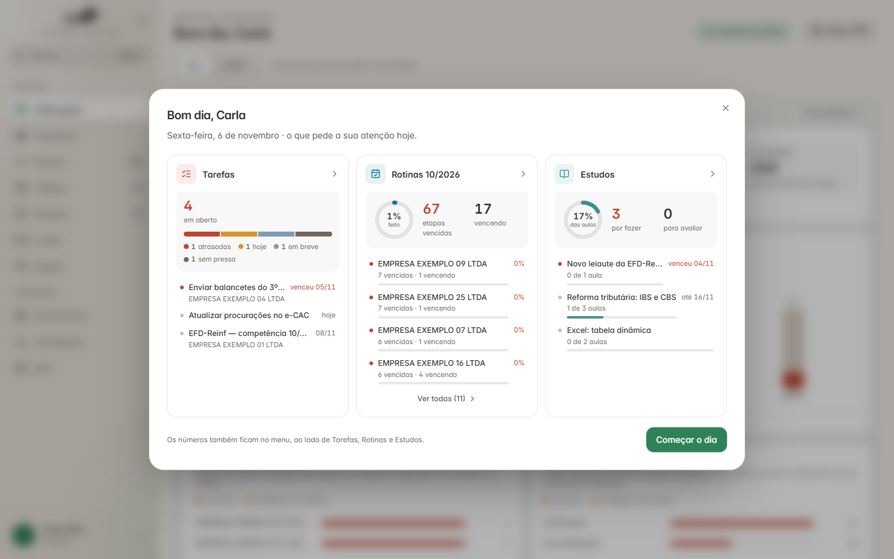

**Tarefas** — painel de andamento à esquerda (cada linha é um filtro), cartões à direita.

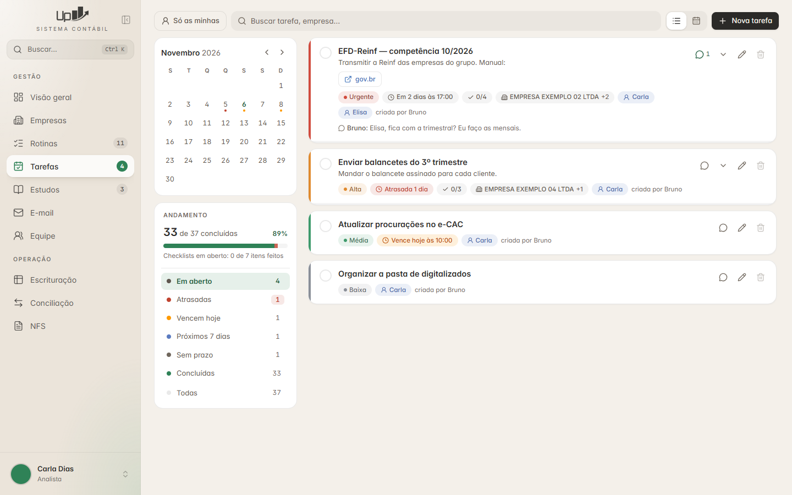

**Estudos** — cartões com a cor do estado, porcentagem e selo do relatório.

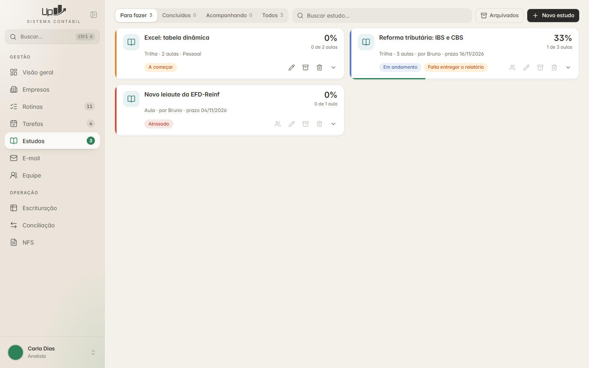

**E-mail** — pastas, lista e leitura em três colunas.

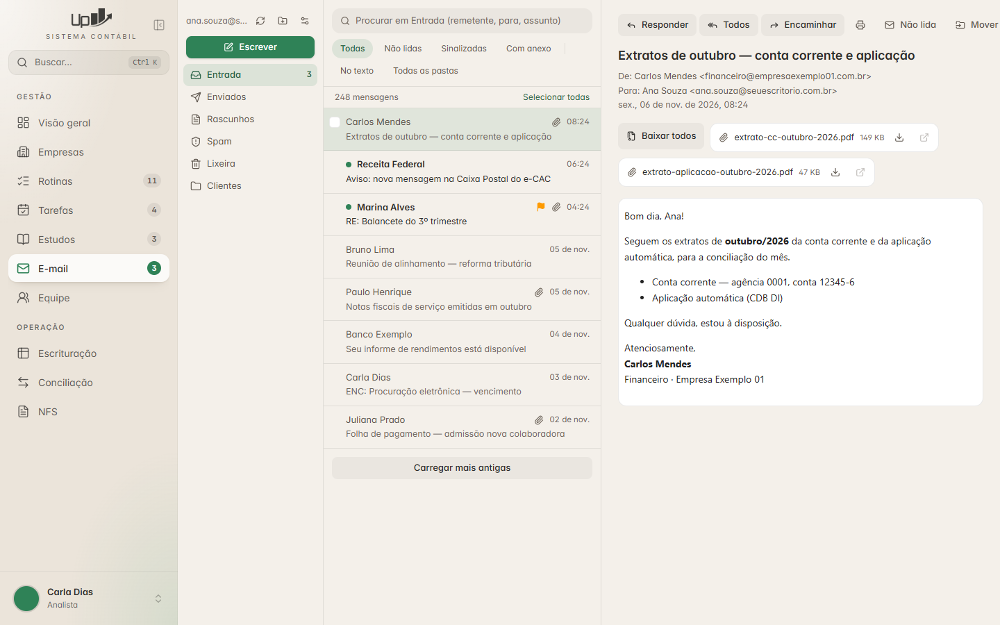

---

## 2. Stack, bibliotecas e frameworks

### 2.1 Como o programa roda

```
┌──────────────── computador do usuário (Windows) ─────────────────┐
│  Janela própria (pywebview + WebView2)                           │
│      └── telas React (arquivos estáticos montados pelo Vite)     │
│                │  fetch + cabeçalho X-Token                      │
│                ▼                                                 │
│  FastAPI + Uvicorn em 127.0.0.1:<porta sorteada>                 │
│      ├── serviços (regras e permissões)                          │
│      ├── motor (dados: SQLite local descartável + JSON)          │
│      ├── IMAP/SMTP direto com o provedor de e-mail  ─────────────┼──► Locaweb (internet)
│      └── lê/grava JSON na pasta compartilhada ───────────────────┼──► Z:\ (rede do escritório)
└──────────────────────────────────────────────────────────────────┘
```

É um **programa desktop**, sem servidor central: cada computador roda o seu Python, e todos
leem e gravam na mesma pasta de rede. O navegador não é usado; a janela é do Windows (WebView2).

### 2.2 Backend (Python)

| Biblioteca | Versão | Para quê |
|---|---|---|
| Python | 3.14 no instalador (roda em 3.12+) | linguagem |
| **FastAPI** | 0.143 | API (rotas) |
| **Uvicorn** | 0.54 | servidor da API, só em `127.0.0.1` |
| **Pydantic** | 2.14 | validar o corpo dos pedidos |
| **pywebview** | 6.2 | janela própria usando o WebView2 do Windows |
| `imaplib`, `smtplib`, `email` | biblioteca padrão | ler e enviar e-mail (sem dependência extra) |
| `ctypes` + `crypt32` (DPAPI) | biblioteca padrão | guardar a senha do e-mail cifrada pelo Windows |
| `sqlite3` | biblioteca padrão | "rascunho" local para as telas serem rápidas |
| cryptography | 50.0 | assinatura das atualizações (não usado nestes módulos) |
| PyInstaller | 6.21 | gerar o `.exe` |
| Inno Setup | 6 | gerar o instalador |
| **pytest** + httpx | 9.0 / 0.28 | testes (o `TestClient` do FastAPI usa httpx) |

### 2.3 Frontend (TypeScript)

| Biblioteca | Versão | Para quê, nestes módulos |
|---|---|---|
| **React** | 19.3 | telas |
| **Vite** | 8.3 | montar as telas (`npm run build` → `frontend/dist`) |
| **TypeScript** | 7.0 | tipos |
| **Tailwind CSS** (`@tailwindcss/vite`) | 4.3 | estilo; cores vêm de variáveis CSS (seção 9) |
| **TanStack Query** | 5.104 | buscar dados, cache, recarregar a cada N segundos, invalidar depois de gravar |
| TanStack Router | 1.170 | troca de telas (histórico em memória, sem endereço) |
| **Radix UI** (dialog, popover, checkbox, tooltip, slot) | 1.x | diálogos, menus suspensos, caixinhas acessíveis |
| shadcn/ui (padrão) + `class-variance-authority`, `clsx`, `tailwind-merge` | — | componentes próprios (`Botao`, `Dialogo`…) no estilo shadcn |
| **Motion** (`motion/react`) | 14.3 | animação de cartões abrindo/fechando (`AnimatePresence`) |
| **Sonner** | 2.0 | avisos rápidos ("Tarefa concluída.") |
| **Lucide** (`lucide-react`) | 1.59 | ícones |
| **DOMPurify** | 3.4.17 (fixa) | limpar o HTML dos e-mails |
| cmdk | 1.1 | busca rápida Ctrl+K (atalhos "Nova tarefa" etc.) |
| Vaul | 1.1 | gaveta lateral (outros módulos) |
| React Hook Form + Zod | 7.90 / 4.6 | formulários maiores (outros módulos; os de tarefa/estudo usam `useState`) |
| TanStack Virtual | 3.14 | listas enormes (outros módulos) |
| Vitest | 5.0 | testes de funções da tela |
| Fonte **Inter** | — | tipografia (com `cv11`, `ss01`) |

**Decisões tomadas** (não reabrir sem motivo): sem Electron, sem Tauri, sem Django, sem pandas.

### 2.4 Se a sua stack for outra

| Peça daqui | Troque por (exemplos) |
|---|---|
| pywebview + FastAPI local | app web normal com backend no servidor (Node/Express, Django, Laravel…) |
| JSON na pasta de rede | banco de dados de verdade (Postgres, MySQL) — as regras continuam iguais |
| DPAPI (senha do e-mail) | macOS Keychain, Linux Secret Service, biblioteca `keyring`; em servidor web: cofre de segredos + cifragem por usuário |
| `imaplib`/`smtplib` | Node: `imapflow` + `nodemailer`; .NET: MailKit; PHP: `webklex/php-imap` + PHPMailer |
| TanStack Query | SWR, RTK Query ou o que o projeto já usa |
| DOMPurify | **não troque**: é o padrão para limpar HTML de e-mail |

---

## 3. Arquitetura e padrões de código

### 3.1 Camadas

```
tela (React)  →  API (FastAPI, só repassa)  →  serviço (regras + permissão)  →  motor (dados)
```

| Camada | Arquivos de referência | O que faz |
|---|---|---|
| Motor | `backend/motor/core/tarefas.py`, `core/estudos.py`, `core/avisos.py` | Lê/grava os dados, regras puras. |
| Serviço | `backend/servicos/tarefas.py`, `estudos.py`, `email_caixa.py` | Junta o que a tela precisa e **confere quem pode o quê**. |
| API | `backend/api/tarefas.py`, `estudos.py`, `email.py` | Rotas finas com Pydantic; nenhuma regra. |
| Tela | `frontend/src/rotas/tarefas/`, `estudos/`, `email/` | Uma pasta por módulo. |
| Cliente | `frontend/src/api/cliente.ts`, `api/tarefas.ts`… | Um arquivo por assunto, com os tipos. |

### 3.2 Rota fina (API)

📄 `backend/api/tarefas.py` (trecho)

```python
from fastapi import APIRouter
from pydantic import BaseModel
from servicos import tarefas as T

rota = APIRouter(prefix="/api/tarefas", tags=["tarefas"])

class Item(BaseModel):
    texto: str = ""
    concluido: bool | None = None      # None = "mantenha o que já está no banco"
    empresa_id: int | None = None
    empresas: list[int] = []           # empresas penduradas neste item (item-grupo)

class Tarefa(BaseModel):
    titulo: str = ""
    descricao: str = ""
    prioridade: int = 1
    prazo: str = ""                    # "AAAA-MM-DD"
    prazo_hora: str = ""               # "HH:MM"
    responsaveis_ids: list[int] = []
    empresas_ids: list[int] = []
    modo_responsaveis: str = "compartilhada"   # ou "individual"
    itens: list[Item] = []

class Marca(BaseModel):
    concluido: bool

@rota.get("")
def listar(filtro: str = "aberto", busca: str = "", dia: str = "", so_minhas: bool = False):
    return T.listar(filtro, busca, dia, so_minhas)

@rota.post("/{tid}/concluir")
def concluir(tid: int, d: Marca):
    return T.concluir(tid, d.concluido)
```

### 3.3 Permissão no serviço → 403 com frase em português

📄 `backend/servicos/empresas.py` e `backend/app.py`

```python
class SemPermissao(Exception):
    pass

# no app:
@app.exception_handler(SemPermissao)
async def sem_permissao(_request, ex):
    return JSONResponse({"detail": str(ex)}, status_code=403)
```

📄 `backend/servicos/tarefas.py` (trecho)

```python
def marcar_item(tid: int, item_id: int, concluido: bool) -> dict:
    u = _usuario()                       # quem está logado (ou SemPermissao "Entre no sistema de novo.")
    t = _tarefa(tid)                     # ou SemPermissao "Essa tarefa não existe mais..."
    if not (T._pode_editar(u) and T._sou_dono(u, t)):
        raise SemPermissao("Só quem é responsável marca o checklist.")
    ...                                  # confere também que o item é DESTA tarefa
    virou = T.marcar_item(item_id, concluido)
    return {"ok": True, "tarefa_concluida": None if virou is None else bool(virou)}
```

Convenção de respostas:

- erro de preenchimento → `200 {"ok": false, "erro": "Dê um título para a tarefa."}` (a tela mostra num aviso);
- "você não pode" → `403 {"detail": "Só quem é responsável marca o checklist."}`;
- deu certo → `{"ok": true, ...}`.

Exceção no módulo de e-mail: as rotas passam por um `_chamar` que transforma `SemPermissao` em 403 e
`ValueError` em **400** (ex.: "E-mail inválido"), e as respostas de erro usam a chave `mensagem`
em vez de `erro` (`{"ok": false, "mensagem": "Informe pelo menos um destinatário."}`).

### 3.4 API só para este computador (senha interna)

📄 `backend/app.py` (encurtado). A API escuta só em `127.0.0.1`, numa porta sorteada, e exige uma
senha gerada a cada abertura (`secrets.token_urlsafe(24)`), que a janela recebe no endereço
(`#api=...&t=...`).

```python
@app.middleware("http")
async def exigir_token(request: Request, chamar):
    if (request.url.path.startswith("/api")
            and request.method != "OPTIONS"
            and not hmac.compare_digest(request.headers.get("x-token") or "", token)):
        return JSONResponse({"detail": "sem permissão"}, status_code=401)
    resposta = await chamar(request)
    if request.url.path.startswith("/api"):
        resposta.headers["Cache-Control"] = "no-store"   # dado nunca fica guardado no navegador
    return resposta

# só atende quem chama por 127.0.0.1/localhost
app.add_middleware(TrustedHostMiddleware, allowed_hosts=["127.0.0.1", "localhost"])
```

O trecho acima deixa de fora três detalhes do original: `/api/docs` e `/api/openapi.json` não pedem
senha (e só existem em modo de desenvolvimento); a senha também é aceita no endereço (`?t=`), **só
em GET** e só em alguns caminhos (fotos, anexos de estudo), porque `` não manda cabeçalho;
e pedidos acima de 60 MB recebem 413.

Num sistema web comum, isto vira o login com sessão/JWT de sempre.

### 3.5 Cliente da API na tela

📄 `frontend/src/api/cliente.ts` (trecho)

```ts
async function chamar<T>(metodo: string, caminho: string, corpo?: unknown): Promise<T> {
  let resposta: Response;
  try {
    resposta = await fetch(API + caminho, {
      method: metodo,
      cache: "no-store",
      headers: { "Content-Type": "application/json", "X-Token": TOKEN },
      body: corpo === undefined ? undefined : JSON.stringify(corpo),
    });
  } catch {
    throw new ErroDaApi("O sistema não respondeu. Feche e abra o programa de novo.");
  }
  if (!resposta.ok) {
    // o Python manda o motivo em «detail» (ex.: «Só o administrador apaga empresas.»)
    let motivo = `Erro ${resposta.status} ao falar com o sistema.`;
    try {
      const d = await resposta.json();
      if (typeof d?.detail === "string") motivo = d.detail;
    } catch { /* sem corpo */ }
    throw new ErroDaApi(motivo);
  }
  return resposta.json() as Promise<T>;
}

export const api = {
  get: <T>(c: string) => chamar<T>("GET", c),
  post: <T>(c: string, corpo?: unknown) => chamar<T>("POST", c, corpo ?? {}),
  put: <T>(c: string, corpo?: unknown) => chamar<T>("PUT", c, corpo ?? {}),
  del: <T>(c: string) => chamar<T>("DELETE", c),
};
```

### 3.6 Buscar, gravar e recarregar (TanStack Query)

📄 `frontend/src/rotas/tarefas/TelaTarefas.tsx` (trecho)

```tsx
const consultas = useQueryClient();
const buscaAdiada = useDeferredValue(busca);          // não pesquisa a cada tecla

const q = useQuery({
  queryKey: ["tarefas", "lista", filtro, buscaAdiada, dia, soMinhas],
  queryFn: () => tarefasApi.listar(filtro, buscaAdiada, dia, soMinhas),
  placeholderData: keepPreviousData,                  // a lista não "pisca" ao trocar o filtro
});

const recarregar = () => {
  consultas.invalidateQueries({ queryKey: ["tarefas"] });
  consultas.invalidateQueries({ queryKey: ["seu-dia"] }); // o número do menu
};

async function concluir(t: Tarefa, v: boolean) {
  try {
    await tarefasApi.concluir(t.id, v);
    if (v) toast.success("Tarefa concluída.");
    recarregar();
  } catch (ex) {
    toast.error((ex as Error).message);               // a frase em português que veio do servidor
  }
}
```

Preferência de tela **por pessoa** (mais de uma pessoa usa o mesmo computador):

```ts
const daPessoa = (chave: string) => `${chave}:${usuarioAtual()?.id ?? 0}`;
localStorage.setItem(daPessoa("tarefas_filtro"), "atrasadas");
```

### 3.7 Onde os dados moram

Pasta compartilhada, em JSON, com um SQLite local descartável (`cache\sessao.db`) só para as telas
serem rápidas:

```
<base>\
├── usuarios\<login>.json
├── tarefas\<uid>.json              uma tarefa por arquivo (checklist e comentários dentro)
├── estudos\<uid>.json              o estudo (só quem criou grava)
├── estudos\_andamento\<login>.json  o que ESTA pessoa marcou (só ela grava)
├── estudos\_anexos\<uid>\...       arquivos das aulas e dos relatórios
├── estudos\_arquivo\<uid>.json     estudos arquivados
├── _avisos\<dia>.<computador>.json     marca de "lembrete já enviado hoje" (um arquivo POR
│                                       computador; a leitura junta todos)
└── _avisos\_tarefas.<computador>.json  registro permanente das tarefas já avisadas
```

O e-mail **não** fica na base: as mensagens ficam no servidor de e-mail.

### 3.8 Regras de ouro

- **Permissão conferida no servidor, sempre.** A tela só esconde botões.
- **Identidade estável entre computadores:** tarefa e comentário por `uid` (`str(uuid4())`, 36
  caracteres com hífens), estudo por `uid` (`uuid4().hex`, 32 caracteres), pessoa por `login`,
  empresa por CNPJ. Nunca grave no arquivo compartilhado o `id`
  numérico de um banco local: ele muda de máquina para máquina.
- **Gravação atômica:** escreve num temporário (com o nome do computador e do processo) e só então
  troca pelo definitivo. Se a rede cair no meio, o arquivo antigo continua inteiro.

  ✂️ versão mínima:

  ```python
  import json, os, socket

  def gravar_json(caminho: str, dados) -> None:
      tmp = f"{caminho}.{socket.gethostname()}.{os.getpid()}.tmp"
      with open(tmp, "w", encoding="utf-8") as f:
          json.dump(dados, f, ensure_ascii=False, indent=1)
          f.flush()
          os.fsync(f.fileno())
      os.replace(tmp, caminho)          # troca atômica
  ```

- **Separe "não existe" de "não consegui ler".** Arquivo corrompido ou meio gravado tratado como
  vazio já apagou trabalho de colega. Na dúvida, não sobrescreva.
- **Um dono por arquivo** sempre que der (ver Estudos e os avisos, cada computador com o seu): sem
  conflito de gravação, sem mesclar. Quando todos gravavam o mesmo `_avisos/<dia>.json`, a marca de
  um computador sumia e o lembrete saía de novo.
- **Mensagens de erro dizem o que fazer:** "Conecte a sua caixa de e-mail primeiro."

---

## 4. Perfis e permissões

📄 `backend/motor/db/banco.py`

```python
CARGOS = [
    ("",           "— não definido —", 0),
    ("estagiario", "Estagiário",       1),
    ("auxiliar",   "Auxiliar",         2),
    ("assistente", "Assistente",       3),
    ("analista",   "Analista",         4),
    ("lider",      "Líder",            5),
    ("socio",      "Sócio",            6),
]   # o administrador conta como 7 quando o nível importa (estudos)

def acesso_total(usuario) -> bool:
    """Vê e altera todas as empresas, rotinas e tarefas: admin e sócio."""
    u = usuario or {}
    return u.get("perfil") == "admin" or (u.get("perfil") == "usuario" and u.get("cargo") == "socio")

def cuida_do_cadastro(usuario) -> bool:
    """Admin, sócio e líder."""
    u = usuario or {}
    return acesso_total(u) or (u.get("perfil") == "usuario" and u.get("cargo") == "lider")
```

| Função | Quem | Usada para |
|---|---|---|
| `acesso_total(u)` | admin ou sócio | ver/alterar todas as tarefas; mudar prazo; apagar qualquer tarefa |
| `cuida_do_cadastro(u)` | admin, sócio ou líder | criar estudo para a equipe; acompanhar a equipe |
| `_pode_editar(u)` | qualquer pessoa logada | criar, marcar, comentar (ponto único para um futuro perfil "só consulta") |

---

## 5. Tarefas

### 5.1 O que é

Quadro de tarefas do escritório: título, descrição, prioridade, prazo (data + hora opcional), um ou
vários responsáveis, empresas ligadas, checklist em dois níveis e comentários.

### 5.2 Telas

| | |
|---|---|
|  | 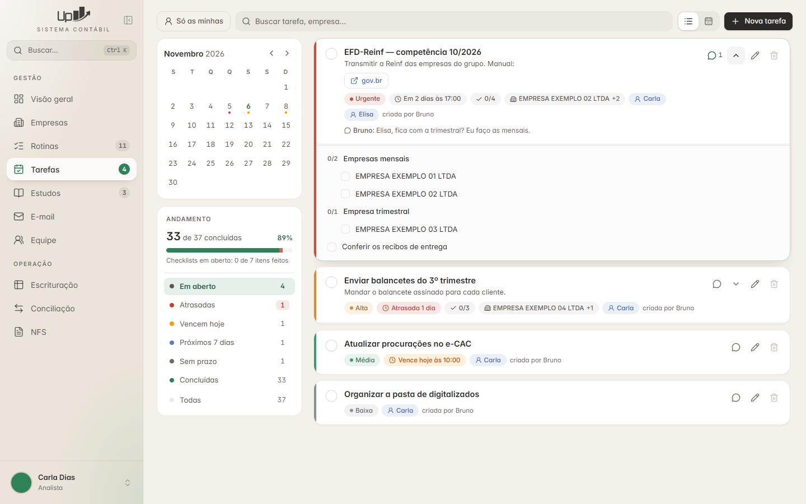 |
| **Lista** — painel de andamento, calendário pequeno e cartões | **Checklist** aberto no próprio cartão, com itens-grupo e empresas |
| 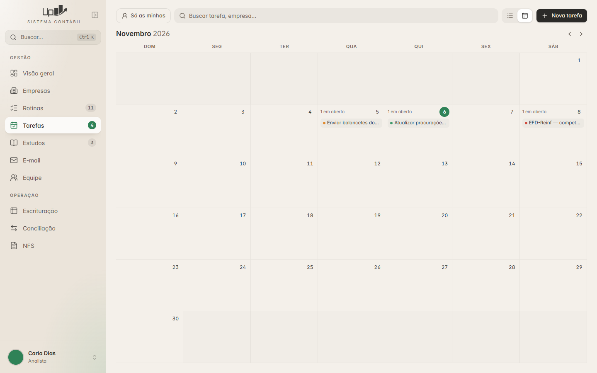 | 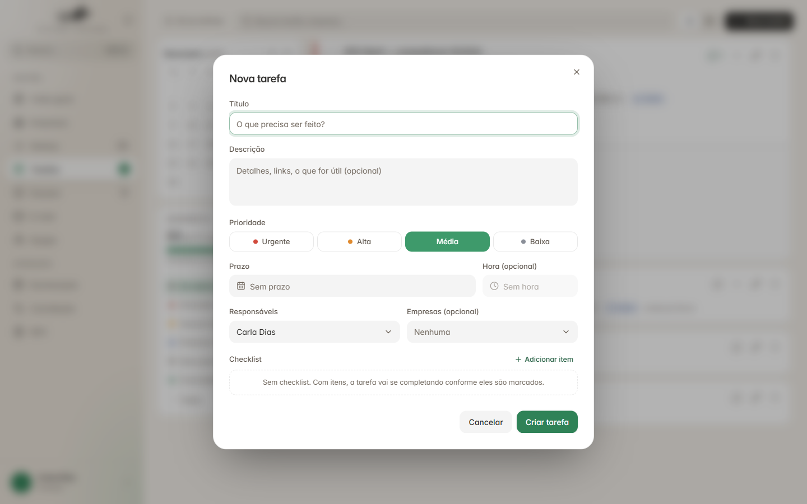 |
| **Calendário** do mês, com as tarefas de cada dia | **Formulário** de nova tarefa |

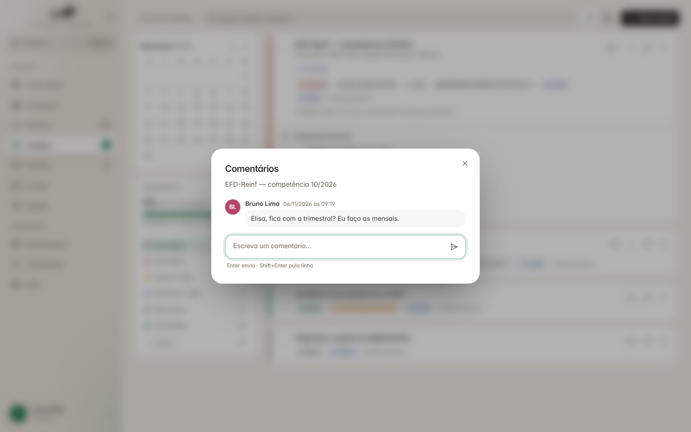

**Comentários** — uma conversa por tarefa (autor, data e hora). O último aparece no cartão.

O que a tela tem (`frontend/src/rotas/tarefas/TelaTarefas.tsx`, `FormTarefa.tsx`, `Comentarios.tsx`):

- **Painel de andamento:** "33 de 37 concluídas", barra de progresso, itens de checklist feitos e a
  lista de situações com contagem — cada linha é também o filtro: em aberto · atrasadas (vermelho) ·
  vencem hoje (âmbar) · próximos 7 dias (azul) · sem prazo · concluídas (verde) · todas.
- **Calendário pequeno** (semana começa na segunda) com bolinhas coloridas nos dias com tarefa;
  clicar num dia filtra a lista. **Calendário grande** (semana começa no domingo) no modo
  "Calendário".
- **"Só as minhas"**, busca por tarefa ou empresa, botão **Nova tarefa**.
- **Cartão:** faixa lateral com a cor da prioridade, círculo para concluir, título, descrição, links
  do texto viram botões ("gov.br"), etiquetas (prioridade, prazo com cor da situação, checklist
  "0/4", empresas "+2", responsáveis, quem criou), último comentário. Ações: comentários (com
  número), expandir checklist, editar, apagar (apagado em cinza quando a pessoa não pode).
- **Formulário:** título, descrição, prioridade em 4 botões (Urgente, Alta, Média, Baixa), prazo e
  hora, responsáveis, empresas, checklist ("Sem checklist. Com itens, a tarefa vai se completando
  conforme eles são marcados.").
- Apagar sempre com diálogo de confirmação. Número de tarefas em aberto no menu lateral.

### 5.3 Modelo de dados

Arquivo `tarefas/<uid>.json`:

```json
{
  "uid": "9f0c2b8e-5d4a-4f1e-8b7c-6a5d4e3f2a1b",
  "titulo": "EFD-Reinf — competência 10/2026",
  "descricao": "O que é a tarefa (não muda).",
  "criador": "maria",
  "responsavel": "joao",
  "responsaveis": ["joao", "ana"],
  "empresa": "12345678000190",
  "empresas": ["12345678000190", "98765432000110"],
  "observacao": "",
  "prioridade": 3,
  "prazo": "2026-11-14",
  "prazo_hora": "17:00",
  "concluida": false,
  "concluida_em": null,
  "criado_em": "2026-11-06 09:12:00",
  "atualizado_em": "2026-11-06 09:12:00",
  "comentarios": [
    {"uid": "3c4d5e6f-…", "autor": "ana", "texto": "Falta o extrato.", "criado_em": "2026-11-06 10:01:02.345"}
  ],
  "itens": [
    {"texto": "Empresas mensais", "concluido": false, "ordem": 0, "pai": "", "empresa": ""},
    {"texto": "", "concluido": true, "ordem": 1, "pai": "Empresas mensais", "empresa": "12345678000190"},
    {"texto": "Conferir os recibos", "concluido": false, "ordem": 2, "pai": "", "empresa": ""}
  ]
}
```

Tabelas equivalentes em SQL (📄 `backend/motor/db/banco.py`, resumido):

```sql
CREATE TABLE tarefas (
    id INTEGER PRIMARY KEY AUTOINCREMENT,
    uid TEXT,                                -- identidade entre computadores
    titulo TEXT NOT NULL, descricao TEXT, observacao TEXT,
    criador_id INTEGER REFERENCES usuarios(id),
    responsavel_id INTEGER REFERENCES usuarios(id),   -- o PRIMEIRO responsável
    empresa_id INTEGER REFERENCES empresas(id) ON DELETE SET NULL,  -- a PRIMEIRA empresa
    prioridade INTEGER NOT NULL DEFAULT 1,   -- 0 baixa · 1 média · 2 alta · 3 urgente
    prazo TEXT,                              -- 'AAAA-MM-DD'
    prazo_hora TEXT,                         -- 'HH:MM' (campo SEPARADO)
    concluida INTEGER NOT NULL DEFAULT 0, concluida_em TEXT,
    resp_login TEXT, criador_login TEXT, empresa_cnpj TEXT,  -- como vieram do arquivo
    criado_em TEXT, atualizado_em TEXT
);
CREATE TABLE tarefa_responsaveis (id INTEGER PRIMARY KEY, tarefa_id INTEGER NOT NULL REFERENCES tarefas(id) ON DELETE CASCADE,
    usuario_id INTEGER REFERENCES usuarios(id), resp_login TEXT, ordem INTEGER NOT NULL DEFAULT 0, UNIQUE(tarefa_id, usuario_id));
CREATE TABLE tarefa_empresas (id INTEGER PRIMARY KEY, tarefa_id INTEGER NOT NULL REFERENCES tarefas(id) ON DELETE CASCADE,
    empresa_id INTEGER REFERENCES empresas(id) ON DELETE CASCADE, empresa_cnpj TEXT, ordem INTEGER NOT NULL DEFAULT 0);
CREATE TABLE tarefa_itens (id INTEGER PRIMARY KEY, tarefa_id INTEGER NOT NULL REFERENCES tarefas(id) ON DELETE CASCADE,
    pai_id INTEGER REFERENCES tarefa_itens(id) ON DELETE CASCADE,          -- item-grupo
    empresa_id INTEGER REFERENCES empresas(id) ON DELETE SET NULL, empresa_cnpj TEXT,
    texto TEXT NOT NULL, concluido INTEGER NOT NULL DEFAULT 0, ordem INTEGER NOT NULL DEFAULT 0);
CREATE TABLE tarefa_comentarios (id INTEGER PRIMARY KEY, uid TEXT, tarefa_id INTEGER NOT NULL REFERENCES tarefas(id) ON DELETE CASCADE,
    usuario_id INTEGER REFERENCES usuarios(id), texto TEXT NOT NULL,
    criado_em TEXT DEFAULT (strftime('%Y-%m-%d %H:%M:%f','now','localtime')));  -- com milésimos
```

Por que cada detalhe existe:

| Decisão | Motivo (já aconteceu) |
|---|---|
| Prazo e hora em campos separados | Os filtros comparam a data com `=` e `<`. Com a hora junto (`2026-11-14 14:30`), a tarefa sumia do dia dela. |
| Vários responsáveis, mas `responsavel` guarda o primeiro | Onde só cabe um nome, e para versões antigas lerem o arquivo. Idem `empresa` × `empresas`. |
| Guardar login/CNPJ como vieram, mesmo desconhecidos | A máquina que não conhecia a pessoa regravava a tarefa **sem dono** — e ela sumia para todo mundo, inclusive do lembrete. |
| Comentários em vez de "campo de observação" | O campo único era apagado sem querer por quem editava depois. |
| Data do comentário com milésimos | Dois recados no mesmo segundo saíam em ordens diferentes em cada computador. |
| Gravar mesclando | Ao gravar, junte com o que um colega gravou nesse meio-tempo (comentários pelo `uid`), em vez de sobrescrever. |

### 5.4 Regras de negócio

**Quem vê:** só os envolvidos (responsáveis e quem criou). Admin/sócio veem todas.

📄 `backend/motor/core/tarefas.py`

```python
def _filtro_visibilidade(usuario):
    """(trecho_sql, parametros) — quais tarefas este usuário enxerga."""
    if acesso_total(usuario):
        return "1=1", []
    uid = usuario.get("id")
    return f"({_SQL_SOU_RESP} OR t.criador_id = ?)", [uid, uid, uid]

def _sou_dono(usuario, t):
    """Só quem é RESPONSÁVEL altera/conclui."""
    return usuario.get("id") in responsaveis_ids(t)

def _posso_mexer(usuario, t):
    """Quem pode alterar a tarefa: os responsáveis, quem criou — e o admin."""
    if acesso_total(usuario):
        return True
    return _sou_dono(usuario, t) or t.get("criador_id") == usuario.get("id")

def pode_excluir(usuario, t):
    """A tarefa inteira só é apagada por quem a criou ou pelo admin/sócio.
    O responsável altera e conclui, mas não some com a tarefa de quem a passou para ele."""
    if not usuario or not t:
        return False
    if acesso_total(usuario):
        return True
    return t.get("criador_id") is not None and t.get("criador_id") == usuario.get("id")
```

| Ação | Quem pode |
|---|---|
| Ver | responsáveis, quem criou, admin/sócio |
| Criar | qualquer pessoa logada |
| Editar textos, empresas, checklist | responsáveis, quem criou, admin/sócio |
| Mudar o prazo ao editar | só admin/sócio (os demais mantêm o prazo original) |
| Concluir/reabrir, marcar item | **só os responsáveis** |
| Comentar | quem pode editar |
| Apagar comentário | quem escreveu, ou admin/sócio |
| Excluir a tarefa (com checklist e comentários) | quem criou, ou admin/sócio |

Cada cartão já vem do servidor com `pode_editar`, `pode_concluir`, `pode_excluir`, `pode_comentar`;
a tela só obedece (e mostra o motivo quando a pessoa clica num botão apagado).

**Vários responsáveis — dois modos na criação:**

📄 `backend/motor/core/tarefas.py` (encurtado)

```python
def criar_tarefa(dados, itens, criador_id=None, usuario=None):
    """"compartilhada" (padrão) → uma tarefa só, com todos os responsáveis;
       "individual"             → uma cópia por pessoa, cada uma com o seu checklist e a sua conclusão."""
    resp = [u for u in (dados.get("responsaveis_ids") or []) if u]
    if dados.get("modo_responsaveis") != "individual" or len(resp) <= 1:
        return [salvar_tarefa(dados, itens, None, criador_id, usuario)]
    criados = []
    for uid in resp:
        copia = dict(dados, responsaveis_ids=[uid], responsavel_id=uid)
        copia_itens = [dict(it, concluido=0) for it in itens]   # o checklist INTEIRO, desmarcado
        criados.append(salvar_tarefa(copia, copia_itens, None, criador_id, usuario))
    return criados
```

**Checklist em dois níveis:**

| Tipo de linha | Como reconhecer | Tem caixinha? |
|---|---|---|
| Item comum | sem empresa, sem filhos | sim |
| Empresa | com `empresa` (pendurada num item ou solta) | sim |
| Item-grupo | sem empresa, **com** filhos | não — mostra "0/2" e fecha sozinho |

O item-grupo **não entra** na conta que fecha a tarefa (senão ela nunca fecharia).

**Fecha e reabre sozinha** — 📄 `backend/motor/core/tarefas.py`

```python
def _ajustar_conclusao(conn, tid, n_antes, f_antes, n_agora, f_agora, concluida):
    """· fecha quando o checklist chega ao fim e a tarefa ainda estava aberta;
       · reabre quando o checklist ESTAVA completo, a tarefa estava concluída,
         e alguém desmarca um item.
    O "reabre" olha o estado ANTERIOR de propósito: quem concluiu à mão, sem
    marcar item por item, não pode ter a tarefa reaberta a cada clique.
    Devolve o novo estado (0/1) ou None quando nada mudou."""
    fechar = (not concluida) and n_agora > 0 and f_agora >= n_agora
    reabrir = bool(concluida) and n_antes > 0 and f_antes >= n_antes and f_agora < n_agora
    if not (fechar or reabrir):
        return None
    novo = 1 if fechar else 0
    conn.execute("UPDATE tarefas SET concluida=?, "
                 "concluida_em=CASE WHEN ?=1 THEN datetime('now','localtime') END WHERE id=?",
                 (novo, novo, tid))
    return novo

def marcar_item(item_id, concluido):
    with _lock, conectar() as conn:
        tid = conn.execute("SELECT tarefa_id FROM tarefa_itens WHERE id=?", (item_id,)).fetchone()["tarefa_id"]
        n_antes, f_antes, concluida = _contagem_checklist(conn, tid)   # o estado de ANTES é LIDO
        conn.execute("UPDATE tarefa_itens SET concluido=? WHERE id=?", (1 if concluido else 0, item_id))
        n, f, _ = _contagem_checklist(conn, tid)
        virou = _ajustar_conclusao(conn, tid, n_antes, f_antes, n, f, concluida)
        conn.commit()
    return virou      # a tela usa isso para redesenhar o cartão
```

Outras regras do checklist:

- **Editar não mexe nos tiques:** o que está marcado no banco fica (alguém pode ter marcado enquanto o
  formulário estava aberto). Marcar é só pelo cartão.
- Empresa tirada da tarefa leva junto a linha dela no checklist.
- Pessoa ou empresa inativa continua aparecendo nas opções quando já está na tarefa (marcada como
  inativa) — senão some da tarefa ao salvar.

**Texto e cor do prazo** — 📄 `backend/motor/core/tarefas.py` (encurtado)

```python
def rotulo_prazo(iso, concluida=False, concluida_em=None, hora=""):
    """Concluída: a conta é contra o DIA DA ENTREGA, nunca contra hoje
    (senão uma tarefa entregue no dia certo diria «Atrasada 12 dias» semanas depois).
    A hora entra no TEXTO, nunca na conta de atraso."""
    d = _para_data(iso)
    if not d:
        return "", "sem"
    if concluida:
        entregue = _para_data(str(concluida_em or "")[:10])
        if not entregue:
            return "Entregue", "entregue"
        atraso = (entregue - d).days
        if atraso <= 0:
            return "Entregue no prazo", "entregue"
        return f"Entregue com {atraso} dia{'s' if atraso > 1 else ''} de atraso", "entregue_atrasada"
    dias = (d - date.today()).days
    sufixo = f" às {hora}" if hora else ""
    if dias < 0:
        return f"Atrasada {-dias} dia{'s' if -dias > 1 else ''}", "atrasada"
    if dias == 0:
        if hora and _hora_ja_passou(hora):
            return f"Venceu hoje às {hora}", "hoje"
        return "Vence hoje" + sufixo, "hoje"
    if dias == 1:
        return "Vence amanhã" + sufixo, "amanha"
    if dias <= 7:
        return f"Em {dias} dias" + sufixo, "futuro"
    return d.strftime("%d/%m/%Y") + sufixo, "futuro"
```

Ordem da lista: abertas antes das concluídas → prioridade (3 → 0) → com prazo antes de sem prazo →
prazo mais próximo → mais antiga primeiro.

### 5.5 API

```
GET    /api/tarefas?filtro=&busca=&dia=&so_minhas=   lista + contagens + pode_criar
GET    /api/tarefas/mes?ano=&mes=&so_minhas=         dias do mês com total/abertas/atrasadas
GET    /api/tarefas/contador                         nº em aberto em que EU sou responsável (menu)
GET    /api/tarefas/opcoes?pessoas=1,2&empresas=3    pessoas e empresas para escolher (+ as já escolhidas)
POST   /api/tarefas                                  criar → { ok, ids: [...] }
GET    /api/tarefas/{id}                             detalhe com checklist em árvore
PUT    /api/tarefas/{id}                             editar
DELETE /api/tarefas/{id}                             excluir
POST   /api/tarefas/{id}/concluir      {concluido}
POST   /api/tarefas/{id}/itens/{item}  {concluido}   → { ok, tarefa_concluida: true|false|null }
GET    /api/tarefas/{id}/comentarios
POST   /api/tarefas/{id}/comentarios   {texto}
DELETE /api/tarefas/{id}/comentarios/{cid}
```

Filtros: `aberto` (padrão), `atrasadas`, `hoje`, `semana` (próximos 7 dias), `sem_prazo`,
`concluidas`, `todas`.

Tipo do cartão na tela — 📄 `frontend/src/api/tarefas.ts`

```ts
export type Situacao = "sem" | "atrasada" | "hoje" | "amanha" | "futuro" | "entregue" | "entregue_atrasada";

export type Tarefa = {
  id: number; titulo: string; descricao: string; prioridade: number;
  prazo: string; prazo_hora: string; prazo_texto: string; situacao: Situacao; concluida: boolean;
  responsaveis: { id: number; nome: string }[]; criador_id: number | null; criador_nome: string;
  empresas: string[]; n_itens: number; n_feitos: number;
  n_comentarios: number; ultimo_comentario: string; ultimo_comentario_autor: string;
  progresso: number;                                   // 0.0 a 1.0
  pode_editar: boolean; pode_concluir: boolean; pode_excluir: boolean; pode_comentar: boolean;
};

export type ItemChecklist = {
  id: number; texto: string; concluido: boolean;
  empresa_id: number | null; empresa_nome: string;
  grupo: boolean; filhos: ItemChecklist[];
};
```

### 5.6 Lista de conferência — Tarefas

- [ ] Quem não participa não vê a tarefa nem pela API (`GET /api/tarefas/{id}` dá 403).
- [ ] Só responsável conclui e marca item; quem criou edita e apaga; responsável não apaga.
- [ ] Prazo e hora separados; filtro "Hoje" acha a tarefa com hora.
- [ ] Modo individual cria uma cópia por pessoa com o checklist inteiro.
- [ ] Último item marcado fecha a tarefa; desmarcar reabre; concluída à mão não reabre ao mexer num item.
- [ ] Item-grupo não tem caixinha e não conta no total.
- [ ] Editar não desfaz tique marcado por outra pessoa enquanto o formulário estava aberto.
- [ ] Concluída mostra "Entregue no prazo" / "Entregue com N dias de atraso", e o número não cresce.
- [ ] Comentário tem autor e data; só o autor (ou admin/sócio) apaga.
- [ ] Número do menu (só as minhas em aberto) atualiza depois de concluir/criar.

---

## 6. Estudos

### 6.1 O que é

Treinamento interno. Um estudo é uma **trilha** (várias aulas) ou uma **aula solta**.

- **Pessoal:** qualquer um cria; só quem criou vê.
- **Para a equipe:** criado por admin, sócio ou líder; vai para a equipe ou só para pessoas/cargos
  escolhidos.

A aula é a mesma para todos; **o andamento é de cada um.**

### 6.2 Telas

| | |
|---|---|
|  | 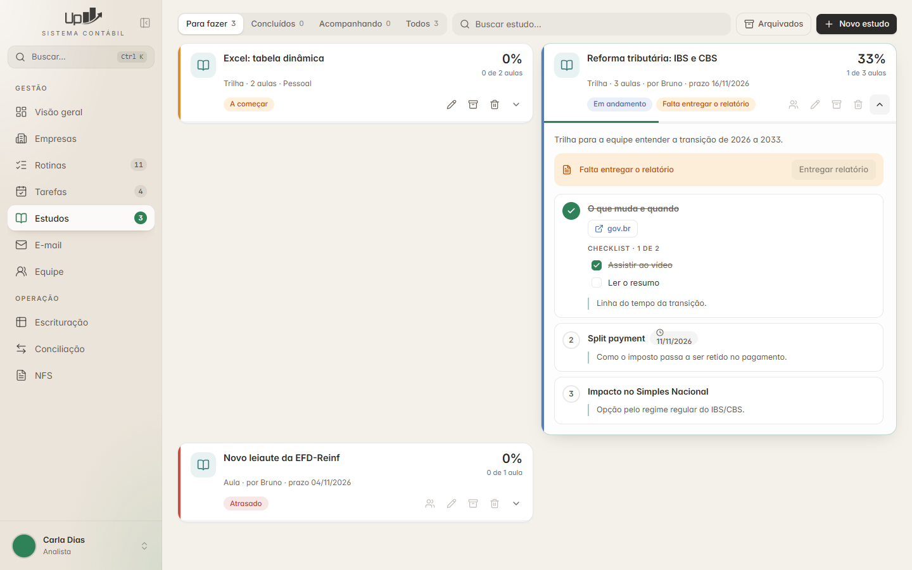 |
| **Para fazer** — visão de quem estuda | **Aulas abertas**: aula vista riscada, checklist, link, prazo da aula, aviso do relatório |
| 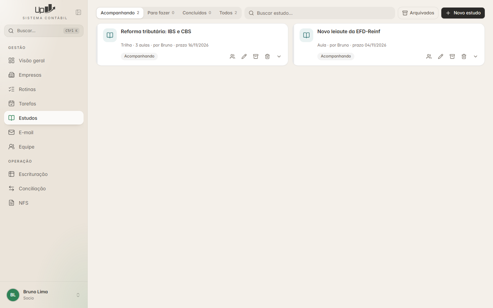 | 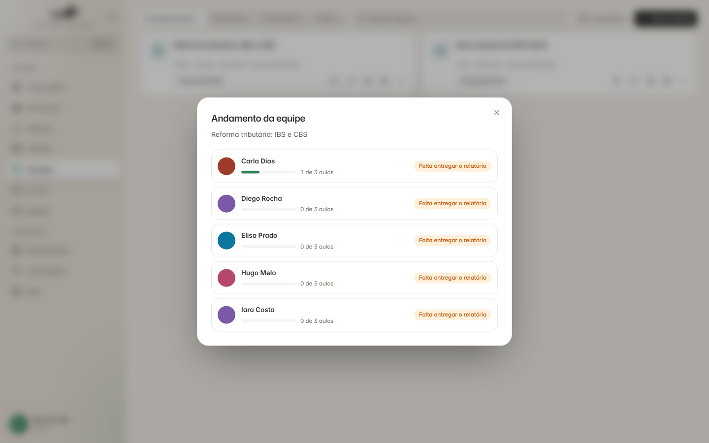 |
| **Acompanhando** — visão de quem criou | **Andamento da equipe**: aulas de cada pessoa e o estado do relatório |

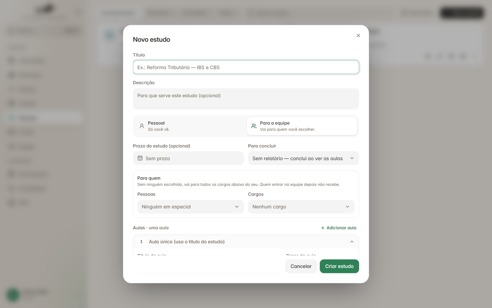

**Formulário:** título, descrição, Pessoal × Para a equipe, prazo, regra para concluir, para quem
(pessoas e cargos; "Sem ninguém escolhido, vai para todos os cargos abaixo do seu. Quem entrar na
equipe depois não recebe."), aulas em sanfona (título, prazo, links, resumo, anexos, checklist).

O que a tela tem (`frontend/src/rotas/estudos/TelaEstudos.tsx`, `FormEstudo.tsx`, `Janelas.tsx`):

- Abas com contagem: pessoa comum → **Para fazer** (padrão), Concluídos, Acompanhando, Todos; quem
  compartilha → **Acompanhando** primeiro. Busca, botão **Arquivados**, **Novo estudo**.
- Cartão: ícone, título, "Trilha · 3 aulas · por Fulano · prazo dd/mm/aaaa", porcentagem e "1 de 3
  aulas", selo do estado, selo do relatório ("Falta entregar o relatório"), barra de progresso no
  rodapé, ações (equipe, editar, arquivar, apagar, ver aulas).
- Cores do estado (📄 `TelaEstudos.tsx`, encurtado):

  ```ts
  const ESTADO = {
    comecar:      { nome: "A começar",    barra: "#E08A2E" },
    andamento:    { nome: "Em andamento", barra: "#5B7BC0" },
    atrasado:     { nome: "Atrasado",     barra: "#D14B3D" },
    concluido:    { nome: "Concluído",    barra: "#3E9A6B" },
    acompanhando: { nome: "Acompanhando", barra: "var(--borda)" },
    arquivado:    { nome: "Arquivado",    barra: "var(--borda)" },
  };
  ```

### 6.3 Modelo de dados — um dono por arquivo

```
estudos/<uid>.json               o estudo           → só quem criou grava
estudos/_andamento/<login>.json  o que a pessoa fez → só ela grava
estudos/_anexos/<uid>/<arquivo>  arquivos das aulas e dos relatórios
estudos/_arquivo/<uid>.json      arquivados (lidos só quando alguém pede)
```

Não há mesclagem nem conflito. A **entrega** do relatório fica no andamento da pessoa; a
**avaliação** fica no arquivo do estudo (quem grava é quem criou).

```json
// estudos/<uid>.json
{
  "uid": "6e8252e6fd7c45f2a66a304555c659a0",
  "titulo": "Reforma tributária: IBS e CBS",
  "descricao": "Trilha para a equipe entender a transição.",
  "criador": "maria", "criador_nivel": 6, "criado_em": "2026-11-06 09:00:00",
  "pessoal": false, "para_logins": [], "para_cargos": [],
  "prazo": "2026-11-16", "relatorio": "aprovar",
  "aulas": [
    {"id": "a1", "titulo": "O que muda e quando", "prazo": "", "links": ["https://www.gov.br/fazenda"],
     "resumo": "Linha do tempo.", "anexos": ["apostila.pdf"],
     "itens": [{"id": "i1", "texto": "Assistir ao vídeo"}, {"id": "i2", "texto": "Ler o resumo"}]}
  ],
  "avaliacoes": {"joao": {"aprovado": false, "obs": "Faltou o exemplo.", "por": "maria", "em": "2026-11-10 15:00:00"}},
  "tipo": "trilha",
  "atualizado_em": "2026-11-06 09:00:00"
}
// "tipo" é calculado ao salvar ("trilha" com mais de uma aula, senão "aula").
// "arquivado_em" só aparece quando o estudo vai para o arquivo.
// Aulas e itens ganham "id" = uuid4().hex[:10] quando chegam sem.

// estudos/_andamento/joao.json
{
  "6e8252e6fd7c45f2a66a304555c659a0": {
    "vistas": ["a1"], "itens": ["i1"],
    "relatorio": {"texto": "Resumo do que aprendi…", "anexo": "relatorio - joao - resumo.pdf", "enviado_em": "2026-11-09 18:00:00"},
    "atualizado_em": "2026-11-09 18:00:00"
  }
}
```

Marcar aula (📄 `backend/motor/core/estudos.py`):

```python
def marcar_aula(login, estudo_uid, aula_id, vista):
    d = andamento(login)                        # lê estudos/_andamento/<login>.json
    reg = d.setdefault(estudo_uid, {})
    vistas = set(reg.get("vistas") or [])
    (vistas.add if vista else vistas.discard)(aula_id)
    reg["vistas"] = sorted(vistas)
    reg["atualizado_em"] = _agora()
    R.gravar_json(f"{PASTA}/_andamento/{login}.json", d)
    return d
```

### 6.4 Regras de negócio

**Para quem vai um estudo da equipe** — 📄 `backend/motor/core/estudos.py`

```python
def _destinado_a(estudo, usuario) -> bool:
    """«Para todos» vale só para quem está ABAIXO de quem criou:
    o sócio cria → líder até estagiário; o líder cria → analista até estagiário.
    Quem está no mesmo nível ou acima só acompanha."""
    logins, cargos = estudo.get("para_logins") or [], estudo.get("para_cargos") or []
    if not logins and not cargos:
        return nivel_cargo(usuario.get("cargo")) < int(estudo.get("criador_nivel", 99))
    return usuario.get("login") in logins or (usuario.get("cargo") or "") in cargos

def destinatarios(estudo):
    """[(login, nome)] de quem recebe. Quem entrou na equipe DEPOIS de o estudo
    ser criado não recebe (o novato não herda centenas de aulas antigas)."""
    if estudo.get("pessoal"):
        return []
    gente = ...  # usuários ativos, perfil 'usuario'
    return [(u["login"], u["nome"]) for u in gente
            if u["login"] != estudo.get("criador") and _destinado_a(estudo, u)
            and (estudo.get("criado_em") or "") >= (u.get("criado_em") or "")]
```

**Quem altera:** quem criou; num estudo da equipe, também admin/sócio. Pessoal × equipe não muda
depois de criado. Arquivado não se edita (tira do arquivo antes).

**Regra para concluir** (escolhida por estudo):

| `relatorio` | Texto na tela | Conclui quando |
|---|---|---|
| `nao` | Sem relatório — conclui ao ver as aulas | viu todas as aulas |
| `anexar` | Relatório obrigatório — conclui ao entregar | viu todas **e** entregou o relatório (texto ou arquivo) |
| `aprovar` | Relatório com aprovação de quem criou | viu todas, entregou **e** quem criou aprovou (pode devolver com observação; a pessoa reenvia) |

**Situação de um estudo para uma pessoa** — 📄 `backend/motor/core/estudos.py`

```python
def situacao(estudo, and_pessoa, login):
    feitas, total = progresso(estudo, and_pessoa)
    reg = and_pessoa.get(estudo.get("uid")) or {}
    rel = reg.get("relatorio") or None
    regra = estudo.get("relatorio") or "nao"
    av = (estudo.get("avaliacoes") or {}).get(login)
    if av and rel and av.get("em", "") < rel.get("enviado_em", ""):
        av = None                                  # reenviou depois de devolvido
    if regra == "nao":
        st_rel = ""
    elif not rel:
        st_rel = "falta"
    elif regra == "anexar":
        st_rel = "entregue"
    else:
        st_rel = "aprovado" if av and av["aprovado"] else ("devolvido" if av else "aguardando")
    aulas_ok = total > 0 and feitas >= total
    concluido = aulas_ok and st_rel in ("", "entregue", "aprovado")
    prazos = [a.get("prazo") for a in estudo.get("aulas") or []
              if a.get("prazo") and a["id"] not in set(reg.get("vistas") or [])]
    return {"feitas": feitas, "total": total, "relatorio": st_rel, "rel": rel, "avaliacao": av,
            "concluido": concluido,
            "atrasado": atrasado(estudo.get("prazo"), concluido) or any(atrasado(p, False) for p in prazos)}
```

**Estado do cartão** (nesta ordem): arquivado → acompanhando (não é para mim) → concluído →
atrasado → em andamento (alguma aula vista, ou relatório aguardando/devolvido) → a começar.

**Arquivar sozinho** (`auto_arquivar`):

- roda quando **quem criou** abre a aba, e só para os estudos que essa pessoa criou (quem grava o
  arquivo do estudo é sempre o criador);
- estudo pessoal: arquivado quando ela concluiu; estudo da equipe: só quando **todos** os
  destinatários concluíram (com relatório aprovado, quando a regra pede);
- os N dias (configurável, padrão 7) contam a partir do **último movimento** (última marcação de
  alguém ou última avaliação), não da conclusão;
- se falhar, ignore (é só arrumação). Arquivar e tirar do arquivo também se faz à mão.

**Relatório:** só depois de concluir todas as aulas; relatório já aprovado não é reenviado.

**Anexos — seguro por padrão** — 📄 `backend/servicos/estudos.py` (encurtado)

```python
MAX_ANEXO = 25 * 1024 * 1024
# lista branca (no projeto fica em backend/janela/acoes.py e vale também para o e-mail)
DOCUMENTOS = {".pdf", ".xlsx", ".xls", ".csv", ".ods", ".docx", ".doc", ".odt", ".pptx", ".ppt",
              ".txt", ".ofx", ".xml", ".png", ".jpg", ".jpeg", ".gif", ".bmp", ".webp",
              ".mp4", ".mp3", ".zip", ".rar", ".7z"}

def _uid_valido(uid) -> str:
    uid = str(uid or "")
    if not re.fullmatch(r"[0-9a-f]{32}", uid):          # nada de "..\..\" no caminho
        raise SemPermissao("Identificação de estudo inválida.")
    return uid

def _gravar_anexo(uid, nome, dados_b64, prefixo=""):
    bruto = base64.b64decode(dados_b64.split(",", 1)[-1])
    if len(bruto) > MAX_ANEXO:
        raise ValueError("O arquivo passa de 25 MB.")
    pasta = E.pasta_anexos(os.path.basename(uid))
    os.makedirs(pasta, exist_ok=True)
    base, ext = os.path.splitext(prefixo + os.path.basename(nome or "arquivo"))
    if ext.lower() not in DOCUMENTOS:
        raise ValueError(f"Esse tipo de arquivo ({ext or 'sem extensão'}) não pode ser anexado.")
    final, n = base + ext, 2
    while os.path.exists(os.path.join(pasta, final)):    # nunca sobrescreve
        final, n = f"{base} ({n}){ext}", n + 1
    with open(os.path.join(pasta, final), "wb") as f:
        f.write(bruto)
    return final
```

O relatório de um colega (`relatorio - <login> - …`) só é visto por quem pode alterar o estudo (quem
criou, ou admin/sócio num estudo da equipe); compare sem diferenciar maiúsculas (o Windows não
diferencia).

**Visão da equipe:** quem criou, e admin/sócio/líder num estudo da equipe, vê por pessoa: aulas
feitas e estado do relatório. **Aprovar/devolver** é só de quem pode alterar o estudo (quem criou,
ou admin/sócio). ⚠️ No projeto de referência a tela mostra os botões também para o líder que não
criou o estudo, e o servidor recusa com 403; no seu projeto, esconda os botões nesse caso.

### 6.5 API

```
GET    /api/estudos?filtro=&busca=&arquivados=     lista + contagens por aba
GET    /api/estudos/opcoes                         pessoas, cargos, regras de relatório, novo_uid
POST   /api/estudos                                criar/editar (uid; "novo": true na criação)
DELETE /api/estudos/{uid}
POST   /api/estudos/{uid}/arquivar      {sim}
POST   /api/estudos/{uid}/aulas/{aula}  {sim}      marcar aula vista
POST   /api/estudos/{uid}/itens/{item}  {sim}      marcar item da aula
POST   /api/estudos/{uid}/anexos        {nome, dados(base64)}
GET    /api/estudos/{uid}/anexos/{nome}            baixar
POST   /api/estudos/{uid}/anexos/{nome}/abrir      abrir no programa do Windows
POST   /api/estudos/{uid}/relatorio     {texto, nome, dados}
GET    /api/estudos/{uid}/equipe
POST   /api/estudos/{uid}/avaliar       {login, aprovado, obs}
```

O `uid` do estudo novo vem de `opcoes` **antes** de salvar, para os anexos poderem subir enquanto o
formulário está aberto. `"novo": true` evita que dois formulários abertos com o mesmo `uid` se
sobrescrevam.

Regras do formulário (no serviço): aula única sem título herda o título do estudo; com várias aulas,
aula com conteúdo e sem título bloqueia ("Dê um título à aula 2 (ou apague a aula).").

### 6.6 Lista de conferência — Estudos

- [ ] Pessoal só aparece para quem criou.
- [ ] "Para todos" vai só para os cargos abaixo de quem criou; com escolha, só para os escolhidos.
- [ ] Quem entrou depois da criação não recebe.
- [ ] Marcar aula grava só no arquivo de andamento da pessoa.
- [ ] As três regras de relatório concluem no momento certo; devolvido → reenviado → volta a "aguardando".
- [ ] Anexo: lista branca, 25 MB, nome sem caminho, sem sobrescrever, `uid` validado.
- [ ] Relatório de colega não abre para quem não criou o estudo.
- [ ] Concluído vai para o arquivo depois de N dias; arquivado não se edita.

---

## 7. E-mail (caixa dentro do sistema)

### 7.1 O que é

Substitui o Outlook: ler, baixar anexos, escrever, responder, encaminhar, rascunhos, pastas, busca.

**Arquitetura:** o computador conversa direto com o provedor por **IMAP** (ler) e **SMTP**
(enviar), com `imaplib` e `smtplib` da biblioteca padrão. **Sem servidor intermediário e sem copiar
mensagens para a base** — como o Outlook em IMAP. Sistema, Outlook e webmail enxergam as mesmas
mensagens e convivem durante a troca.

Provedor de referência: Locaweb — IMAP `email-ssl.com.br:993` (SSL) e SMTP `email-ssl.com.br:465`
(SSL). A tela deixa trocar servidor e porta. **Gmail e Microsoft 365 exigem OAuth** (outro fluxo de
login); este guia cobre e-mail + senha.

Referência: `backend/servicos/email_caixa.py` (≈1.250 linhas), `frontend/src/rotas/email/`,
plano em `docs/PLANO-EMAIL.md`.

### 7.2 Telas

| | |
|---|---|
| 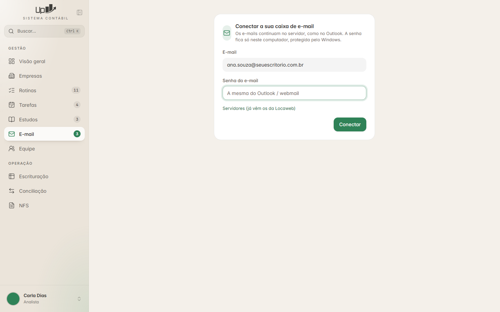 |  |
| **Conectar** — cada pessoa liga a sua caixa uma vez | **Caixa** — pastas, lista e leitura |

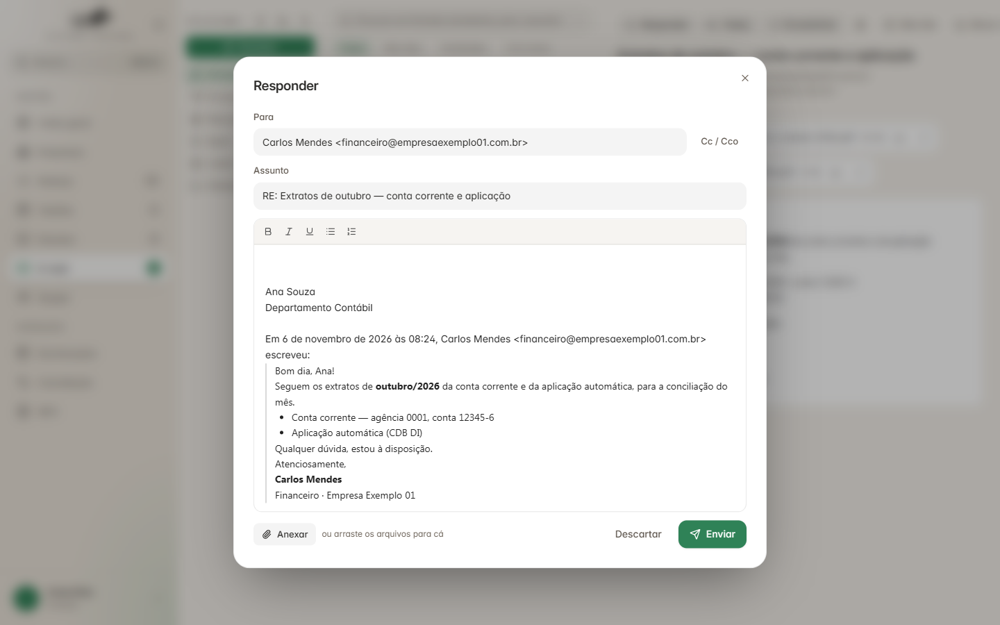

**Escrever/Responder** — Para, Cc/Cco, assunto, editor simples, assinatura e texto citado, anexar
(botão ou arrastar), Descartar e Enviar.

O que a tela tem (`frontend/src/rotas/email/TelaEmail.tsx`, `Escrever.tsx`):

- **Coluna de pastas:** endereço da conta, atualizar, nova pasta, ajustes (nome, assinatura),
  botão **Escrever**, pastas com ícone e número de não lidas; soltar e-mails arrastados numa pasta
  move.
- **Lista:** busca, filtros (Todas, Não lidas, Sinalizadas, Com anexo, No texto, Todas as pastas),
  total, "Selecionar todas", remetente, assunto, hora ou data, clipe de anexo, bandeira, bolinha +
  negrito se não lida, seleção múltipla, menu do botão direito, "Carregar mais antigas".
- **Leitura:** Responder, Todos, Encaminhar, Imprimir, Não lida, Mover, Excluir; assunto, de, para,
  data; anexos com Baixar/Abrir e "Baixar todos"; corpo na moldura segura; conversa.
- Tema escuro: o e-mail é invertido com CSS; botão "Ver com as cores originais".

### 7.3 Conta e senha protegida

- **Cada pessoa conecta a SUA caixa**, uma vez. A conexão é testada antes de salvar; senha errada
  não é guardada.
- **A senha fica só neste computador, cifrada pelo Windows (DPAPI)**, ligada ao usuário do Windows.
  Nunca vai para a base compartilhada, o git ou o código. Trocou de computador → conecta de novo.

📄 `backend/servicos/email_caixa.py`

```python
def _dpapi(dados: bytes, cifrar: bool) -> bytes:
    import ctypes
    from ctypes import wintypes

    class Blob(ctypes.Structure):
        _fields_ = [("tam", wintypes.DWORD), ("dados", ctypes.POINTER(ctypes.c_char))]

    buf = ctypes.create_string_buffer(dados, len(dados))
    entrada = Blob(len(dados), ctypes.cast(buf, ctypes.POINTER(ctypes.c_char)))
    saida = Blob()
    c = ctypes.windll.crypt32
    f = c.CryptProtectData if cifrar else c.CryptUnprotectData
    if not f(ctypes.byref(entrada), None, None, None, None, 0x1, ctypes.byref(saida)):  # 0x1: sem janela
        raise OSError("O Windows não conseguiu proteger/ler a senha do e-mail.")
    try:
        return ctypes.string_at(saida.dados, saida.tam)
    finally:
        ctypes.windll.kernel32.LocalFree(saida.dados)
```

Fora do Windows: `keyring` (Python), Keychain (macOS), Secret Service (Linux). Num sistema web, um
cofre de segredos no servidor, com a senha cifrada por usuário.

Perfil: nome de exibição e assinatura HTML (limite de 2 MB); dá para importar as assinaturas do
Outlook de `%APPDATA%\Microsoft\Signatures` (com as imagens).

### 7.4 Conexões IMAP

Regras que evitam travar a tela:

1. **Uma conexão aberta por pessoa, reaproveitada.** Abrir IMAP a cada clique é lento.
2. Antes de usar, `NOOP` com **timeout curto (5 s)**: o provedor derruba conexões paradas, e esperar
   o timeout normal (25 s) travaria a tela. Caiu → abre outra sozinho.
3. **Conexão e trava separadas para o trabalho de fundo** (número de não lidas, aviso de e-mail
   novo). Senão apagar/enviar esperava na fila atrás deles.
4. **Conexão avulsa para buscas demoradas** (no texto, em todas as pastas), com timeout de 180 s: o
   servidor leva cerca de 1 min para ler 3 mil e-mails, e o resto da caixa continua funcionando.

📄 `backend/servicos/email_caixa.py` (encurtado)

```python
TEMPO, TESTE_VIVA, FUNDO = 25, 5, "|fundo"

def _abrir(c: dict, tempo=TEMPO):
    m = imaplib.IMAP4_SSL(c["imap_servidor"], int(c["imap_porta"]), timeout=tempo)
    m.login(c["email"], c["senha"])
    return m

def _conexao(login: str, fundo=False):
    chave = login + FUNDO if fundo else login
    m = _conexoes.get(chave)
    if m is not None:
        sock = getattr(m, "sock", None)
        try:
            if sock: sock.settimeout(TESTE_VIVA)
            m.noop()                                  # ainda viva?
            if sock: sock.settimeout(TEMPO)
            return m
        except Exception:
            _conexoes.pop(chave, None)                # caiu: descarta e abre outra
    c = _ler_conta(login)
    if not c:
        raise SemPermissao("Conecte a sua caixa de e-mail primeiro.")
    try:
        m = _abrir(c)
    except imaplib.IMAP4.error:
        raise SemPermissao("O servidor recusou o e-mail ou a senha. Confira em «Conta».")
    except OSError:
        raise SemPermissao("Não consegui falar com o servidor de e-mail. Confira a internet.")
    _conexoes[chave] = m
    return m

def _q(pasta: str) -> str:
    """Nome de pasta entre aspas para o IMAP — sem quebra de linha: nada de comando escondido."""
    if not pasta or "\r" in pasta or "\n" in pasta:
        raise ValueError("Pasta inválida.")
    return '"' + pasta.replace("\\", "\\\\").replace('"', '\\"') + '"'
```

### 7.5 Pastas

- Reconhecidas pelas marcas especiais do IMAP (`\Sent`, `\Drafts`, `\Trash`, `\Junk`, `\Archive`)
  e, na falta delas, pelo nome ("Sent", "Itens enviados", "Lixo eletrônico"…).
- Ordem fixa: Entrada, Enviados, Rascunhos, Arquivo, Spam, Lixeira; depois as da pessoa.
- Nomes vêm em **UTF-7 modificado** (RFC 3501): converta para mostrar e para gravar.
- A tela pede a lista de pastas a cada 120 s e o servidor sempre pergunta de novo ao IMAP. Só as
  ações internas (mover, excluir, enviar, rascunho) usam uma cópia guardada por 2 minutos;
  criar/renomear/apagar pasta a renovam. As pastas especiais não se apagam.

📄 `backend/servicos/email_caixa.py`

```python
def _de_utf7(nome: str) -> str:
    """«Itens Exclu&AO0-dos» → «Itens Excluídos»."""
    def trocar(m):
        t = m.group(1)
        if not t:
            return "&"
        t = t.replace(",", "/")
        return base64.b64decode(t + "=" * (-len(t) % 4)).decode("utf-16-be")
    return re.sub(r"&([^-]*)-", trocar, nome)

_ESPECIAIS = {"\\inbox": "entrada", "\\sent": "enviados", "\\drafts": "rascunhos",
              "\\trash": "lixeira", "\\junk": "spam", "\\archive": "arquivo"}
_POR_NOME = {"inbox": "entrada", "sent": "enviados", "itens enviados": "enviados", "sent items": "enviados",
             "drafts": "rascunhos", "trash": "lixeira", "itens excluídos": "lixeira", "deleted items": "lixeira",
             "spam": "spam", "junk": "spam", "lixo eletrônico": "spam"}   # (lista encurtada)
```

### 7.6 Lista e leitura

- Lista **por UID**, 50 por página; "Carregar mais antigas" pede `antes_de=<menor UID visto>`.
  Busca só cabeçalhos, flags e tamanho.
- Filtros IMAP:

  ```python
  FILTROS = {"todas": [], "nao_lidas": ["UNSEEN"], "sinalizadas": ["FLAGGED"],
             "anexo": ["HEADER", "Content-Type", "multipart/mixed"]}
  ```

- Leitura com `BODY.PEEK[]` (não marca como lida sozinho) e depois `STORE +FLAGS (\Seen)` de
  propósito. As 3 últimas mensagens ficam em memória para reabrir rápido.

📄 `backend/servicos/email_caixa.py` (encurtado)

```python
def ler(pasta: str, uid: int) -> dict:
    u = _usuario()
    with _trava:
        msg = _buscar(_conexao(u["login"]), pasta, uid, marcar_lida=True)
    corpo = msg.get_body(preferencelist=("html", "plain"))
    html, texto = "", ""
    if corpo is not None:
        if corpo.get_content_subtype() == "html":
            html = corpo.get_content()
        else:
            texto = corpo.get_content()
    # imagens coladas no corpo (cid:) viram data: para aparecerem
    if html:
        for parte in msg.walk():
            cid = str(parte.get("content-id") or "").strip("<>")
            if cid and parte.get_content_maintype() == "image":
                dado = base64.b64encode(parte.get_payload(decode=True) or b"").decode()
                html = html.replace(f"cid:{cid}", f"data:{parte.get_content_type()};base64,{dado}")
    anexos = [{"indice": i, "nome": a.get_filename() or f"anexo-{i + 1}", "tipo": a.get_content_type(),
               "tamanho": len(a.get_payload(decode=True) or b"")}
              for i, a in enumerate(msg.iter_attachments())]
    return {"uid": uid, "assunto": _texto(msg.get("subject")) or "(sem assunto)",
            "de": _pessoas(msg.get("from")), "para": _pessoas(msg.get("to")), "cc": _pessoas(msg.get("cc")),
            "data": _data(msg.get("date")), "html": html, "texto": texto, "anexos": anexos,
            "responder_para": _pessoas(msg.get("reply-to")) or _pessoas(msg.get("from")),
            "message_id": _texto(msg.get("message-id")), "references": _texto(msg.get("references")),
            "rascunho_id": _texto(msg.get("x-plus-rascunho"))}
```

- **Conversa:** junta as mensagens pelo assunto sem `RE:/RES:/ENC:/FW:/FWD:/TR:`.
- **Ações em lote:** marcar lida/não lida, sinalizar, mover (arrastando), excluir. UIDs agrupados em
  faixas (`1,2,3,7,8` → `1:3,7:8`) para "selecionar a pasta inteira" não estourar o comando.
- **Excluir** vai para a Lixeira; na Lixeira apaga de vez (a tela pergunta antes).
- **Mover sem o comando MOVE** = `COPY` + `\Deleted` + apagar **só estas** (com `UIDPLUS`,
  `UID EXPUNGE`). O `EXPUNGE` comum apagaria também o que o Outlook marcou e ainda não limpou.

### 7.7 Segurança (o e-mail vem de fora)

**HTML limpo com DOMPurify e mostrado numa moldura sem scripts** — 📄 `frontend/src/rotas/email/TelaEmail.tsx` (encurtado)

```tsx
import DOMPurify from "dompurify";

function limpar(html: string) {
  DOMPurify.removeAllHooks();
  DOMPurify.addHook("afterSanitizeAttributes", (no) => {
    if (no.tagName === "A") no.setAttribute("rel", "noopener noreferrer");
  });
  const limpo = DOMPurify.sanitize(html, {
    WHOLE_DOCUMENT: true,
    FORBID_TAGS: ["form", "input", "button", "textarea", "select", "iframe", "object", "embed", "link", "meta", "base"],
    FORBID_ATTR: ["srcset"],
  });
  DOMPurify.removeAllHooks();
  return limpo;
}

function Corpo({ m }: { m: Mensagem }) {
  const moldura = useRef<HTMLIFrameElement>(null);
  const limpo = useMemo(() => (m.html ? limpar(m.html) : ""), [m.html]);

  // solta o observador e o clique da mensagem anterior (ao trocar de mensagem ou fechar)
  const soltar = useRef<() => void>(() => {});
  useEffect(() => () => soltar.current(), [limpo]);

  const aoCarregar = () => {
    const doc = moldura.current?.contentDocument;
    if (!doc || !moldura.current) return;
    // a altura acompanha o conteúdo (as imagens chegam depois)
    const ajustar = () => moldura.current && (moldura.current.style.height = `${doc.documentElement.scrollHeight + 8}px`);
    ajustar();
    soltar.current();
    const obs = new ResizeObserver(ajustar);
    obs.observe(doc.documentElement);
    // clique em link: só http/https, aberto no navegador do sistema
    const clique = (e: MouseEvent) => {
      const a = (e.target as HTMLElement).closest("a");
      if (!a) return;
      e.preventDefault();
      const href = a.getAttribute("href") ?? "";
      if (/^https?:\/\//i.test(href)) abrirLink(href);
    };
    doc.addEventListener("click", clique);
    soltar.current = () => {
      obs.disconnect();
      doc.removeEventListener("click", clique);
      soltar.current = () => {};
    };
  };

  if (!m.html) return <pre className="whitespace-pre-wrap">{m.texto || "(mensagem sem texto)"}</pre>;
  return (
    <iframe ref={moldura} title="Conteúdo do e-mail"
      sandbox="allow-same-origin"          // SEM allow-scripts: nada roda dentro
      srcDoc={limpo} onLoad={aoCarregar}
      className="min-h-[200px] w-full rounded-xl border border-borda bg-white" />
  );
}
```

Tema escuro do e-mail (inverte cores e desinverte imagens):

```ts
const CSS_ESCURO = `html{filter:invert(1) hue-rotate(180deg);background:#e6e6e6!important}
img,video,picture,svg,[background],[style*="background-image"]{filter:invert(1) hue-rotate(180deg)}`;
```

**Anexos:**

- Nome limpo (`basename` + troca de `\/:*?"<>|`).
- **Abrir direto só a lista branca** (a mesma dos Estudos); `.exe`, `.html`, `.bat` etc. só baixam
  ("Esse tipo de arquivo não abre direto. Use «Baixar» e confira antes de abrir.").
- Anexo aberto vai para `<pasta do computador>\email\anexos_abertos` com a marca "veio da internet"
  (o Office abre em modo protegido e bloqueia macros). A pasta é limpa ao desconectar ou sair, e a
  limpeza diária apaga o que tiver mais de 1 dia:

  📄 `backend/servicos/email_caixa.py`

  ```python
  def _marcar_internet(caminho):
      """Marca «veio da internet» (Mark of the Web)."""
      if os.name != "nt":
          return
      with open(caminho + ":Zone.Identifier", "w", encoding="ascii") as f:
          f.write("[ZoneTransfer]\r\nZoneId=3\r\n")
  ```

**Imagens externas aparecem sempre** — decisão do escritório (21/10/2026), embora o plano inicial
previsse um clique "Mostrar imagens". Saiba o custo: imagem externa avisa ao remetente que o e-mail
foi aberto. Se o seu cliente preferir privacidade, bloqueie `src` externos no DOMPurify e mostre o
botão.

### 7.8 Escrever e enviar

- Modos: novo · responder · responder a todos · encaminhar (leva os anexos originais) · continuar
  rascunho.
- Editor simples (`contentEditable`; negrito, itálico, sublinhado, listas). O HTML de fora é limpo com
  DOMPurify **ao entrar no editor** (o que é colado, a assinatura, o e-mail citado): saem `style`,
  scripts, formulários. O que a pessoa digitou vai como está.
- Para/Cc/Cco com sugestões: últimos 400 enviados + colegas do escritório + e-mails das empresas
  (cache de 10 min).
- Anexos do computador (botão ou arrastar), **limite total de 25 MB**, conferido antes de decodificar.
- Resposta leva `In-Reply-To` e `References` (o Outlook agrupa a conversa).
- Imagem `data:` (ex.: logo da assinatura) vira anexo interno `cid:` — o Gmail não mostra `data:`.
- **Cco** não vai no cabeçalho: entra só na lista de destinatários do SMTP.

📄 `backend/servicos/email_caixa.py` (encurtado)

```python
def _montar(d: dict, u: dict, c: dict, exigir_destino=True):
    para, cc, cco = _enderecos(d.get("para")), _enderecos(d.get("cc")), _enderecos(d.get("cco"))
    if exigir_destino and not (para or cc or cco):
        raise _NaoDa("Informe pelo menos um destinatário.")
    msg = EmailMessage()
    msg["From"] = formataddr((c.get("nome_exibicao") or u.get("nome") or "", c["email"]))
    if para: msg["To"] = ", ".join(formataddr(x) for x in para)
    if cc:   msg["Cc"] = ", ".join(formataddr(x) for x in cc)
    msg["Subject"] = (d.get("assunto") or "").replace("\r", " ").replace("\n", " ").strip()
    msg["Date"] = formatdate(localtime=True)
    msg["Message-ID"] = make_msgid(domain=c["email"].split("@")[-1])
    resposta = d.get("resposta") or {}
    if resposta.get("message_id"):
        mid = str(resposta["message_id"]).replace("\r", "").replace("\n", "")
        msg["In-Reply-To"] = mid
        msg["References"] = (str(resposta.get("references") or "") + " " + mid).strip()
    html = d.get("html") or ""
    msg.set_content(_texto_de_html(html) or " ")                       # versão texto
    msg.add_alternative(f'<!doctype html><html><head><meta charset="utf-8"></head><body>{html}</body></html>',
                        subtype="html")
    for a in d.get("anexos") or []:
        dados = base64.b64decode(str(a.get("dados") or "").split(",", 1)[-1])
        nome = os.path.basename(str(a.get("nome") or "anexo").replace("\\", "/")) or "anexo"
        principal, _, sub = mimetypes_tipo(nome).partition("/")
        msg.add_attachment(dados, maintype=principal, subtype=sub, filename=nome)
    return msg, [e for _n, e in para + cc + cco]                      # Cco só aqui
```

**Envio** — porta 465 usa SSL direto; outra porta usa STARTTLS:

```python
def _smtp(c: dict, msg, destinos) -> tuple[str, list]:
    """(motivo da falha — '' se saiu; quem foi recusado)."""
    try:
        porta = int(c.get("smtp_porta") or 465)
        if porta == 465:
            s = smtplib.SMTP_SSL(c["smtp_servidor"], porta, timeout=TEMPO, context=ssl.create_default_context())
        else:
            s = smtplib.SMTP(c["smtp_servidor"], porta, timeout=TEMPO)
            s.starttls(context=ssl.create_default_context())
        with s:
            s.login(c["email"], c["senha"])
            recusados = s.send_message(msg, from_addr=c["email"], to_addrs=destinos) or {}
    except smtplib.SMTPAuthenticationError:
        return "O servidor de saída recusou o e-mail ou a senha.", []
    except smtplib.SMTPRecipientsRefused as ex:
        return "O servidor recusou: " + ", ".join(ex.recipients), []
    except (smtplib.SMTPException, OSError) as ex:
        return f"Não consegui enviar ({ex}). Confira a internet e o servidor de saída.", []
    return "", list(recusados)
```

**Depois de sair, em segundo plano:** cópia em "Enviados" (`APPEND` com `\Seen`), marca a original
como respondida (`\Answered`) e apaga o rascunho. A tela diz "enviado" assim que o SMTP aceita —
subir a cópia com anexos demora. Se a cópia falhar, **avise a pessoa** (o e-mail saiu, mas não
aparece em Enviados).

```python
def enviar(d: dict) -> dict:
    u = _usuario()
    c = _conta_ou_erro(u)
    try:
        msg, destinos = _montar(d, u, c)
    except _NaoDa as ex:
        return {"ok": False, "mensagem": str(ex)}
    erro, recusados = _smtp(c, msg, destinos)
    if erro:
        return {"ok": False, "mensagem": erro}
    bruto = msg.as_bytes()
    _em_segundo_plano(lambda: _guardar_enviado(u["login"], bruto, d.get("resposta"),
                                               d.get("rascunho_id"), d.get("substitui")))
    return {"ok": True, "aviso": ("Saiu, mas o servidor não entregou para: " + ", ".join(recusados)) if recusados else ""}
```

**Rascunho salvo sozinho** no IMAP (pasta Rascunhos, aparece no Outlook também), 3 segundos depois
da última alteração e ao fechar a janela. Um cabeçalho próprio (`X-Plus-Rascunho: <id>`) faz a nova
versão substituir a anterior em vez de acumular cópias.

📄 `frontend/src/rotas/email/Escrever.tsx` (trecho)

```tsx
useEffect(() => {
  if (primeira.current) return void (primeira.current = false);
  rascunho.current.sujo = true;
  const t = window.setTimeout(() => void guardar(), 3000);   // 3 s parado → salva
  return () => window.clearTimeout(t);
}, [f, html, anexos, originais]);
// fechou a janela (X, Esc, clicou fora): guarda o que faltou
useEffect(() => () => void guardar(), []);
```

### 7.9 Avisos de e-mail novo

- **Número do menu:** `STATUS INBOX (UNSEEN)` — um pedido só.
- **Pop-up de e-mail novo:** a tela guarda o maior UID já visto (por pessoa); o servidor devolve
  até 5 não lidos com UID maior. Na primeira chamada só devolve o UID atual (não dispara pop-up de
  tudo o que já existia).
- **Frequência:** pop-up a cada 20 s (também com a janela em segundo plano); lista da Entrada a cada
  30 s; outras pastas e a lista de pastas a cada 120 s; nada durante busca no texto.
- **Sem internet:** devolve 0/vazio em silêncio, sem erro na tela.

📄 `frontend/src/componentes/layout/Avisos.tsx` (trecho)

```tsx
const em = useQuery({
  queryKey: ["avisos-email", ultimoEmail],
  queryFn: () => emailApi.novos(ultimoEmail),
  refetchInterval: 20_000,               // e-mail novo aparece em até 20 s
  refetchIntervalInBackground: true,
});
```

### 7.10 API

```
GET  /api/email/conta                    POST /api/email/conta  {email, senha, imap_*, smtp_*}
POST /api/email/conta/desconectar        POST /api/email/perfil {nome_exibicao, assinatura_html}
GET  /api/email/assinaturas-outlook
GET  /api/email/nao-lidas                GET  /api/email/novos?depois_de=
GET  /api/email/pastas                   POST /api/email/pastas/criar | renomear | apagar
GET  /api/email/mensagens?pasta=&antes_de=&filtro=&termo=&no_texto=
GET  /api/email/mensagem?pasta=&uid=     GET  /api/email/conversa?pasta=&uid=
GET  /api/email/anexo?pasta=&uid=&indice=     POST /api/email/anexo/abrir?pasta=&uid=&indice=
GET  /api/email/anexos-zip?pasta=&uid=
POST /api/email/marcar  {pasta, uids, lida?, sinalizada?}
POST /api/email/mover   {pasta, uids, destino}
POST /api/email/excluir {pasta, uids}           → { ok, lixeira: true|false }
POST /api/email/enviar  {para, cc, cco, assunto, html, anexos, originais?, resposta?, rascunho_id?, substitui?}
POST /api/email/rascunho                 POST /api/email/rascunho/descartar
GET  /api/email/contatos                 GET  /api/email/buscar?termo=&no_texto=
```

Tipos principais — 📄 `frontend/src/api/email.ts`

```ts
export type Pasta = { id: string; nome: string; caminho: string; tipo: string; nao_lidas: number; total: number };
export type Pessoa = { nome: string; email: string };
export type Resumo = { uid: number; de: Pessoa[]; para: Pessoa[]; assunto: string; data: string;
                       lida: boolean; sinalizada: boolean; anexo: boolean; tamanho: number };
export type Anexo = { indice: number; nome: string; tipo: string; tamanho: number };
export type Mensagem = { uid: number; assunto: string; de: Pessoa[]; para: Pessoa[]; cc: Pessoa[]; data: string;
                         html: string; texto: string; anexos: Anexo[]; responder_para: Pessoa[];
                         message_id: string; references: string; rascunho_id: string };
```

### 7.11 Lista de conferência — E-mail

- [ ] Senha nunca sai do computador (nem log, nem base, nem git); senha errada não é guardada.
- [ ] Conexão caída é trocada em até 5 s, sem travar a tela por 25 s.
- [ ] Contador e pop-up usam conexão própria; enviar/apagar não esperam por eles.
- [ ] Pasta com quebra de linha é recusada; nomes com acento (UTF-7) aparecem certos.
- [ ] HTML passa pelo DOMPurify e aparece em `<iframe sandbox>` **sem** `allow-scripts`.
- [ ] Link só abre se for http/https, fora do programa.
- [ ] `.exe` não abre direto; anexo aberto ganha a marca "veio da internet".
- [ ] Enviado aparece em "Enviados" (também no Outlook); resposta fica agrupada na conversa.
- [ ] Rascunho não se multiplica a cada salvamento.
- [ ] Excluir manda para a Lixeira; na Lixeira apaga só os escolhidos.

---

## 8. E-mails automáticos (lembretes)

Referência: `backend/motor/core/avisos.py`, `core/email_rotina.py`.

Os lembretes saem por uma conta de envio própria do sistema (separada das caixas pessoais),
configurada pelo administrador.

**Aviso na hora — tarefa nova:** quando alguém cria/repassa uma tarefa para você. Sai em segundo
plano, sem segurar a tela; ao fechar o programa, espera alguns segundos os envios pendentes.

**E-mail do dia — um só por pessoa**, com até três blocos (oito atrasadas = um e-mail, não oito):

1. **Atrasadas** — o prazo passou;
2. **Prazo chegando** — vence hoje ou nos próximos N dias úteis (sábado e domingo não contam;
   feriados não são considerados);
3. **Outras em aberto** — só as de que a pessoa **nunca foi avisada**. É este bloco, junto com o
   registro permanente, que põe o escritório em dia na primeira vez que os lembretes são ligados.

**Quem dispara, sem servidor:** o primeiro computador que abrir o programa no dia ("carteiro"). Se
ninguém abrir, nada sai; para horário garantido, use um agendador (ex.: Agendador de Tarefas do
Windows, cron).

**Duas travas contra repetição** — ✂️ simplificado de `backend/motor/core/avisos.py`

```python
def disparar_lembretes(hoje=None) -> dict:
    """Nunca levanta erro: isto roda ao abrir o programa e não pode atrapalhar quem quer trabalhar.
    · `dia|<e-mail>`   no arquivo do DIA   → no máximo um e-mail por pessoa por dia;
    · `<uid>|<e-mail>` no registro PERMANENTE → cada tarefa comunicada uma vez só."""
    resumo = {"enviados": 0, "pulados": 0, "falhas": 0, "postas_em_dia": 0}
    try:
        hj = hoje or date.today().isoformat()
        ja_avisadas = repositorio.tarefas_avisadas()
        for p in pessoas_ativas_com_email():
            trava_dia = f"dia|{p['email'].lower()}"
            if repositorio.aviso_ja_enviado(hj, trava_dia):
                resumo["pulados"] += 1
                continue
            tarefas = _tarefas_da_pessoa(conn, p["id"])
            novas = [t["uid"] for t in tarefas if chave_tarefa(t["uid"], p["email"]) not in ja_avisadas]
            monte = montar_lembrete(p["nome"], tarefas, hj, uids_novas=novas)
            if monte is None:
                continue                                  # nada a avisar: não marca, não envia
            assunto, texto, html = monte
            # a marca do dia é gravada DEPOIS de o e-mail sair: marcada antes, um programa
            # fechado no meio do envio deixava a marca sem e-mail, e ninguém recebia o lembrete
            if enviar(p["email"], assunto, texto, html):
                repositorio.marcar_aviso(hj, trava_dia, p["nome"])
                repositorio.marcar_tarefas_avisadas([chave_tarefa(t["uid"], p["email"]) for t in tarefas], p["nome"])
                resumo["enviados"] += 1
            else:
                resumo["falhas"] += 1
        repositorio.podar_tarefas_avisadas(uids_que_ainda_existem)   # o registro não cresce para sempre
    except Exception as ex:
        log.error("falha ao disparar os lembretes: %s", ex)
    return resumo
```

- E-mail em HTML **e** texto puro (`multipart/alternative`), com nome do escritório e rodapé
  configuráveis.
- **Pasta na nuvem** (Google Drive etc.) demora alguns segundos para mostrar a marca aos outros
  computadores: se duas pessoas abrirem no mesmo minuto, pode sair um e-mail repetido. É o preço de
  não haver servidor.

**E-mail ao cliente da rotina mensal** — diferente dos lembretes, sai pela **caixa pessoal de quem
está logado** (a mesma da seção 7), com a assinatura dela, cópia em Enviados e respostas para o
endereço escolhido. **Modelos com campos que se preenchem:**
`{empresa} {cnpj} {competencia} {documentos} {responsavel} {setor} {escritorio}` — modo manual (a
pessoa revisa e envia) ou automático a partir do N-ésimo dia útil do mês seguinte.

**Base de teste não manda e-mail automático:**

```python
if os.environ.get("SISTEMA_CONTABIL_SEM_EMAIL") == "1":
    if os.environ.get("SISTEMA_CONTABIL_EMAIL_SIMULADO") == "1":
        return _guardar_ensaio(para, assunto, texto, cc)   # vira um .eml na pasta de teste
    log.info("e-mail NÃO enviado (base de teste) para %s: %s", para, assunto)
    return False
```

O que a pessoa escreve à mão na caixa de e-mail sai mesmo na base de teste. Nos testes automáticos,
o enviador é trocado por uma função falsa (`definir_enviador`).

---

## 9. Visual: tema, cores e componentes

Objetivo: telas modernas e calmas, com cara de produto Apple — fundo bege claro, cartões brancos com
cantos bem arredondados, sombras leves, uma cor de destaque (verde), fonte Inter, animações curtas.

### 9.1 Cores como variáveis (claro e escuro)

📄 `frontend/src/index.css` (trecho)

```css
@import "tailwindcss";
@custom-variant dark (&:where(.escuro, .escuro *));   /* tema escuro: classe .escuro no <html> */

:root {
  --fundo: #f4f0ea;      --superficie: #ffffff;
  --texto: #2b2a28;      --texto-2: #5e564e;      --texto-3: #70675d;
  --borda: rgb(43 42 40 / 0.1);                   --campo: rgb(43 42 40 / 0.05);
  --verde: #2f8257;      --verde-texto: #245f42;  --vermelho: #c0432f;
  --primario: #2b2a28;   --primario-texto: #f4f0ea;
  --menu: #ebe4da;
  /* situação: no prazo · com atraso · vencida · a vencer */
  --st-prazo: #2f8257;   --st-atraso: #c98a1b;    --st-vencida: #c0432f;  --st-aberta: #d6cdc1;
  /* tipo, no calendário e no "Seu dia" */
  --tp-rotina: #4f6fa8;  --tp-tarefa: #8a5a83;    --tp-estudo: #2f7f7a;
}
.escuro {
  --fundo: #191816;      --superficie: #22211e;
  --texto: #f2ede6;      --texto-2: #c9c0b5;      --texto-3: #9a9288;
  --borda: rgb(255 255 255 / 0.09);               --campo: rgb(255 255 255 / 0.06);
  --verde: #2e8257;      --verde-texto: #8ed3ae;  --vermelho: #e8735f;
  --primario: #e6ded3;   --primario-texto: #1b1a18;
  --menu: #262420;
}

/* as variáveis viram classes do Tailwind: bg-superficie, text-texto-2, border-borda, bg-verde… */
@theme inline {
  --font-sans: "Inter", -apple-system, "Segoe UI", system-ui, sans-serif;
  --color-fundo: var(--fundo);
  --color-superficie: var(--superficie);
  --color-texto: var(--texto);
  --color-texto-2: var(--texto-2);
  --color-texto-3: var(--texto-3);
  --color-borda: var(--borda);
  --color-campo: var(--campo);
  --color-verde: var(--verde);
  --color-verde-texto: var(--verde-texto);
  --color-vermelho: var(--vermelho);
  --color-primario: var(--primario);
  --color-primario-texto: var(--primario-texto);
}
```

Trocar o tema = `document.documentElement.classList.toggle("escuro", tema === "escuro")` e guardar a
escolha.

### 9.2 Cores com significado

| Significado | Cor | Onde |
|---|---|---|
| Urgente / atrasado / vencida | vermelho | prioridade 3, prazo vencido, estudo atrasado |
| Alta / vence hoje / a começar | âmbar/laranja | prioridade 2, prazo do dia |
| Próximos dias / em andamento | azul (`#5B7BC0`) | filtro "Próximos 7 dias", estudo em andamento |
| Concluído / no prazo / ação principal | verde | concluídas, botões "Criar", "Enviar" |
| Sem prazo / acompanhando / baixa | cinza | neutros |

### 9.3 Botão no estilo shadcn

📄 `frontend/src/componentes/ui/botao.tsx`

```tsx
import { Slot } from "@radix-ui/react-slot";
import { cva, type VariantProps } from "class-variance-authority";
import { Loader2 } from "lucide-react";

const variantes = cva(
  "inline-flex items-center justify-center gap-2 whitespace-nowrap font-medium transition-all " +
    "duration-200 active:scale-[0.97] disabled:pointer-events-none disabled:opacity-50 cursor-default " +
    "focus-visible:ring-4 focus-visible:ring-verde/25",
  {
    variants: {
      variante: {
        primario: "bg-primario text-primario-texto shadow-sm hover:brightness-110",
        verde: "bg-verde text-white shadow-sm hover:brightness-105",
        leve: "bg-campo text-texto hover:bg-borda",
        fantasma: "text-texto-2 hover:bg-campo hover:text-texto",
        link: "text-verde-texto hover:underline px-0 h-auto",
      },
      tamanho: {
        p: "h-8 px-3 text-[13px] rounded-lg",
        m: "h-10 px-4 text-sm rounded-xl",
        g: "h-12 px-5 text-[15px] rounded-2xl",
        icone: "size-9 rounded-full",
      },
    },
    defaultVariants: { variante: "primario", tamanho: "m" },
  },
);

export const Botao = React.forwardRef<HTMLButtonElement, Props>(
  ({ className, variante, tamanho, asChild, carregando, children, disabled, ...props }, ref) => {
    const Comp = asChild ? Slot : "button";
    return (
      <Comp ref={ref} className={cn(variantes({ variante, tamanho }), className)}
            disabled={disabled || carregando} {...props}>
        {carregando && <Loader2 className="size-4 animate-spin" />}
        {children}
      </Comp>
    );
  },
);
```

### 9.4 Padrões que se repetem nas três telas

- **Cartão:** `rounded-2xl border border-borda bg-superficie` com sombra quase invisível; ao passar o
  mouse, a borda fica esverdeada e a sombra cresce. Faixa colorida de 4 px (`w-1`) à esquerda
  (prioridade ou estado). Ações em ícones à direita, apagadas quando a pessoa não pode. Clicar em
  qualquer parte do cartão expande.
- **Etiquetas ("chips")** pequenas e arredondadas: cor de fundo 12% + texto da mesma cor.
- **Diálogos** (Radix Dialog) com fundo desfocado; formulários em diálogo com botões "Cancelar"
  (leve) e ação principal (verde) no rodapé.
- **Animações** com Motion: cartão entra subindo 6 px e aparecendo (200 ms) e sai encolhendo
  (`AnimatePresence`, `layout`); painéis com mola (`type: "spring"`).
- **Avisos** com Sonner: `toast.success("Tarefa concluída.")` e `toast.error(<frase que veio do servidor>)`.
- **Lista vazia** com uma frase que explica e, quando faz sentido, o botão de criar.
- **Ícones** Lucide, traço fino, 16–18 px.

---

## 10. Testes

Referência: `tests/api/test_tarefas.py` (6 testes), `test_estudos.py` (4), `test_email.py` (30),
com pytest e o `TestClient` do FastAPI, numa **base nova e temporária** (nunca na base real).

### 10.1 Base temporária e troca de usuário

📄 `tests/api/test_tarefas.py` (trecho)

```python
H = {"x-token": "t"}

@pytest.fixture(scope="module")
def c():
    base = tempfile.mkdtemp(prefix="plus_tarefas_")
    B.autorizar_base_nova(base)
    B.definir_servidor_path(base)
    ...
    cli = TestClient(app.criar_api("t"))
    cli.post("/api/sessao/primeiro-usuario", headers=H,
             json={"nome": "Chefe Teste", "login": "chefe", "senha": "segredo1"})
    # cria Ana, Bia e Caio como usuários comuns
    return cli

def _entrar(c, login):
    S._logado["usuario"] = None
    S._zerar_freio()          # senão os logins repetidos batem no freio de tentativas
    assert c.post("/api/sessao/entrar", headers=H, json={"login": login, "senha": "segredo1"}).json()["ok"]
```

### 10.2 Servidor de e-mail falso (sem rede, sem conta)

📄 `tests/api/test_email.py` (encurtado)

```python
class Falso:
    """O mínimo de um servidor IMAP que o sistema usa."""
    capabilities = ("IMAP4REV1", "MOVE")

    def __init__(self):
        self.caixas = {"INBOX": {}, "INBOX.Lixeira": {}, "INBOX.Enviados": {}, "INBOX.Rascunhos": {},
                       "INBOX.Itens Exclu&AO0-dos.Antigos": {}}          # testa o UTF-7 também
        # mensagens de exemplo, inclusive uma com <script> e outra com virus.exe
        ...

    def noop(self): return "OK", [b""]
    def logout(self): return "BYE", [b""]
    def append(self, q, flags, _data, bruto): ...
    def list(self, *a): ...
    # select, uid(SEARCH/FETCH/STORE/MOVE/COPY/EXPUNGE), status, create, rename, delete…

@pytest.fixture
def servidor(monkeypatch):
    f = Falso()
    def abrir(conta, tempo=None):
        if conta["senha"] != "certa":
            raise imaplib.IMAP4.error("AUTHENTICATIONFAILED")
        return f
    monkeypatch.setattr(EM, "_abrir", abrir)                       # troca a conexão de verdade
    monkeypatch.setattr(EM, "_em_segundo_plano", lambda f: f())    # cópia em Enviados na hora
    EM._conexoes.clear()
    return f
```

O SMTP é trocado do mesmo jeito (`monkeypatch.setattr(smtplib, "SMTP_SSL", SmtpFalso)`).

### 10.3 O que vale testar

| Módulo | Testes |
|---|---|
| Tarefas | cada linha da tabela de permissões (5.4); checklist fecha e reabre (incluindo "concluí à mão e desmarquei um item" → não reabre); modo individual; "editar não desfaz tique"; prazo com hora no filtro "Hoje" |
| Estudos | destinatários por nível, por cargo e por login; novato não recebe estudo antigo; situação em cada regra de relatório; anexo com extensão proibida, nome com `..\`, arquivo repetido |
| E-mail | senha errada não guarda; senha cifrada no PC; pastas e não lidas; ler marca como lida; `.exe` não abre direto; excluir → Lixeira → apaga; pasta com quebra de linha recusada; enviar com anexo + cópia em Enviados; responder liga a conversa; encaminhar leva anexos; sem MOVE não apaga o que o Outlook marcou; rascunho troca e some ao enviar; conexão caída é trocada |
| Lembretes | um e-mail por pessoa por dia; tarefa comunicada uma vez; base de teste não envia |

O teste com uma conta de e-mail de verdade é feito por uma pessoa, na tela, digitando a própria senha.

---

## 11. Ordem de construção e lista de conferência

1. **Usuários e permissões** (seção 4) — tudo depende disso.
2. **Tarefas:** modelo → criar/listar/editar → concluir → checklist simples → checklist em dois
   níveis com fechar/reabrir → comentários → filtros e contagens → calendário → número no menu →
   aviso de tarefa nova.
3. **Estudos:** estudo pessoal com aulas → andamento por pessoa → estudo da equipe com
   destinatários → anexos → relatório (`anexar`, depois `aprovar`) → visão da equipe → arquivar.
4. **E-mail:** conectar/testar com senha protegida → pastas → lista paginada → leitura segura →
   anexos → marcar/mover/excluir → escrever/enviar + cópia em Enviados → rascunhos → busca → número
   no menu e pop-up.
5. **Lembretes por e-mail** (precisa de Tarefas e de uma conta de envio).

Antes de dar por pronto, em cada módulo:

- [ ] Toda regra de permissão está no servidor e tem teste.
- [ ] Toda mensagem de erro está em português e diz o que fazer.
- [ ] Nenhum `id` local foi gravado no arquivo/tabela compartilhada no lugar de `uid`/login/CNPJ.
- [ ] Gravações são atômicas; ler mal não vira "apagar tudo".
- [ ] Tema claro e escuro conferidos.
- [ ] Testado numa base de teste, nunca na de produção.
- [ ] Nenhuma senha, token ou dado de cliente no git.

---

## 12. Armadilhas conhecidas (resumo)

| Armadilha | O que acontecia | Como evitar |
|---|---|---|
| Permissão só na tela | Qualquer um alterava pela API | Conferir no serviço; teste por regra |
| `id` local no arquivo compartilhado | Outro computador ligava a tarefa à pessoa errada | `uid`, login, CNPJ |
| Login/CNPJ desconhecido descartado | Tarefa perdia o dono para todo mundo | Guardar como veio e religar depois |
| Prazo e hora no mesmo campo | Tarefa sumia do filtro "Hoje" | Campos separados |
| Atraso contado contra hoje depois de concluir | "Atrasada 12 dias" numa tarefa entregue no prazo | Contar contra o dia da entrega |
| Reabrir sem olhar o estado anterior | Tarefa concluída à mão reabria a cada clique | Ler o antes do banco |
| Editar regravando os tiques | Desfazia o que o colega marcou | Editar não mexe nos tiques |
| Campo único de observação | Texto de um apagava o do outro | Comentários com autor e data |
| Arquivo ilegível tratado como vazio | Trabalho do colega apagado | Separar "não existe" de "não li" |
| Estudo "para todos" sem limite | Sócio recebia estudo do líder; novato herdava tudo | Só cargos abaixo; só quem já estava |
| `EXPUNGE` comum | Apagava o que o Outlook só tinha marcado | `UID EXPUNGE` / só estas |
| Conexão IMAP parada | Tela travava 25 s | `NOOP` com timeout de 5 s |
| Contador na mesma fila das ações | Enviar esperava a contagem | Conexão de fundo separada |
| HTML do e-mail sem limpeza | Script e rastreador rodando | DOMPurify + iframe sem scripts |
| Esperar a cópia em Enviados | "Enviando…" demorava com anexos | Responder após o SMTP; cópia em segundo plano |
| Marca de "lembrete enviado" antes do envio | Programa fechado no meio = lembrete perdido | Marcar depois de enviar |
| Todos os computadores no mesmo arquivo de marcas | A marca de um sumia; o lembrete saía de novo | Um arquivo por computador; a leitura junta |
| E-mail automático na base de teste | Cliente recebia e-mail de teste | Variável `SISTEMA_CONTABIL_SEM_EMAIL=1` |
