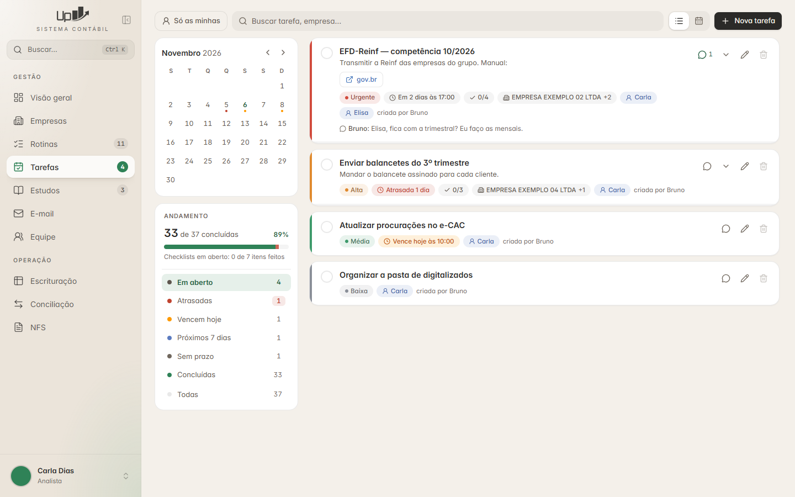
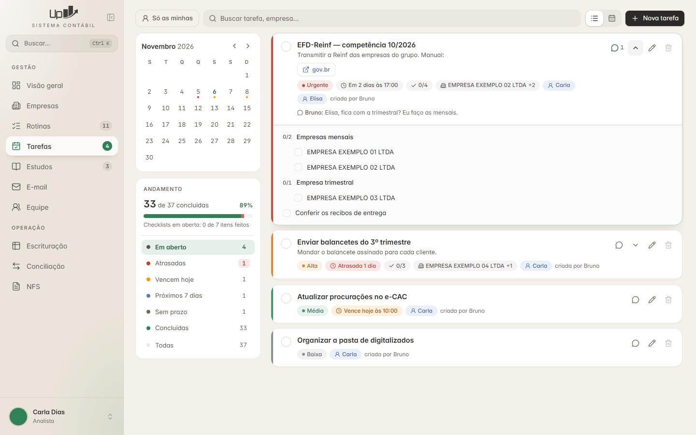
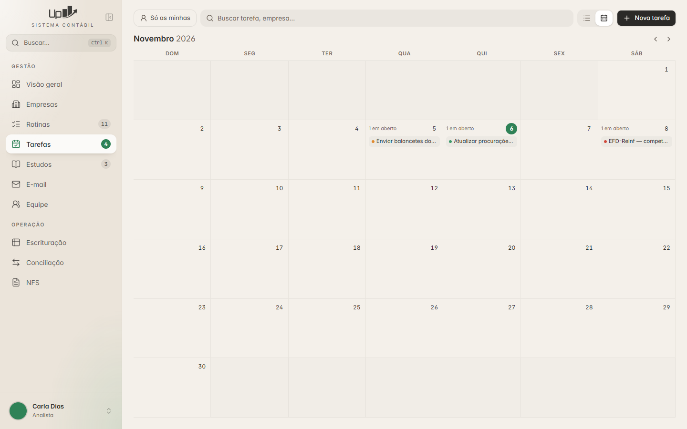
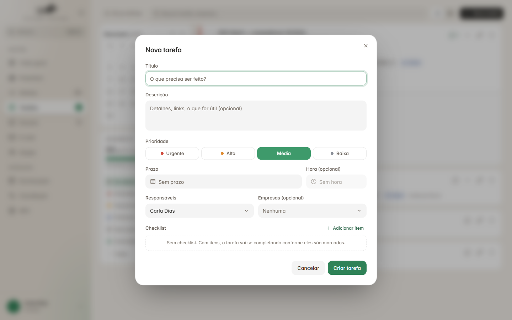
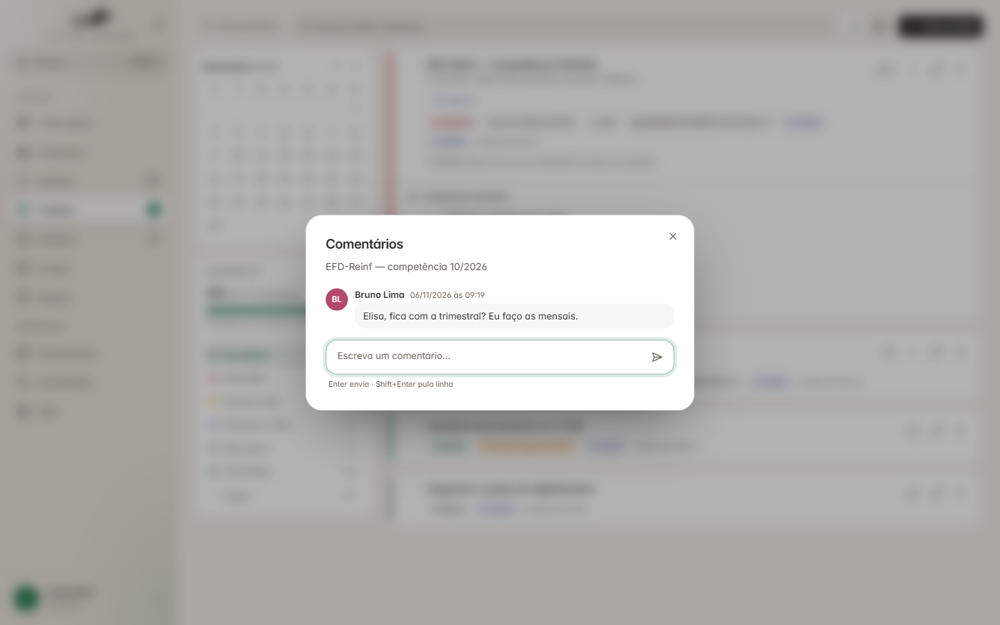

# Tarefas

← [Visual: tema, cores e componentes](../01-base/visual.md) · [Índice do guia](../README.md) · [Tarefas — modelo de dados](dados.md) →

---

**Nesta pasta:**

- [Tarefas — modelo de dados](dados.md)
- [Tarefas — regras de negócio](regras.md)
- [Tarefas — API](api.md)
- [Tarefas — lista de conferência](conferencia.md)

## O que é

Quadro de tarefas do escritório: título, descrição, prioridade, prazo (data + hora opcional), um ou
vários responsáveis, empresas ligadas, checklist em dois níveis e comentários.

## Telas

| | |
|---|---|
|  |  |
| **Lista** — painel de andamento, calendário pequeno e cartões | **Checklist** aberto no próprio cartão, com itens-grupo e empresas |
|  |  |
| **Calendário** do mês, com as tarefas de cada dia | **Formulário** de nova tarefa |

**Comentários** — uma conversa por tarefa (autor, data e hora). O último aparece no cartão.

O que a tela tem (`frontend/src/rotas/tarefas/TelaTarefas.tsx`, `FormTarefa.tsx`, `Comentarios.tsx`):

- **Painel de andamento:** "33 de 37 concluídas", barra de progresso, itens de checklist feitos e a
  lista de situações com contagem — cada linha é também o filtro: em aberto · atrasadas (vermelho) ·
  vencem hoje (âmbar) · próximos 7 dias (azul) · sem prazo · concluídas (verde) · todas.
- **Calendário pequeno** (semana começa na segunda) com bolinhas coloridas nos dias com tarefa;
  clicar num dia filtra a lista. **Calendário grande** (semana começa no domingo) no modo
  "Calendário".
- **"Só as minhas"**, busca por tarefa ou empresa, botão **Nova tarefa**.
- **Cartão:** faixa lateral com a cor da prioridade, círculo para concluir, título, descrição, links
  do texto viram botões ("gov.br"), etiquetas (prioridade, prazo com cor da situação, checklist
  "0/4", empresas "+2", responsáveis, quem criou), último comentário. Ações: comentários (com
  número), expandir checklist, editar, apagar (apagado em cinza quando a pessoa não pode).
- **Formulário:** título, descrição, prioridade em 4 botões (Urgente, Alta, Média, Baixa), prazo e
  hora, responsáveis, empresas, checklist ("Sem checklist. Com itens, a tarefa vai se completando
  conforme eles são marcados.").
- Apagar sempre com diálogo de confirmação. Número de tarefas em aberto no menu lateral.

---

← [Visual: tema, cores e componentes](../01-base/visual.md) · [Índice do guia](../README.md) · [Tarefas — modelo de dados](dados.md) →
