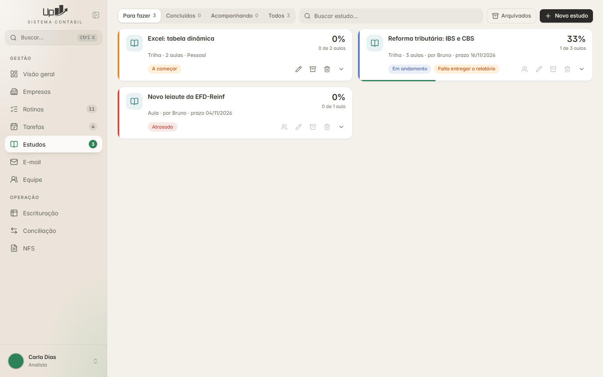
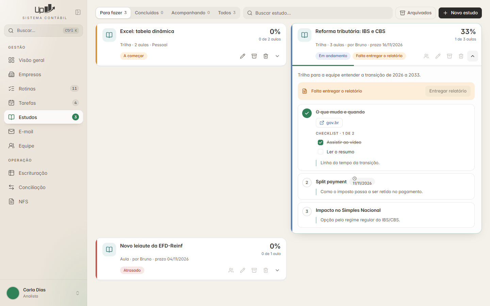
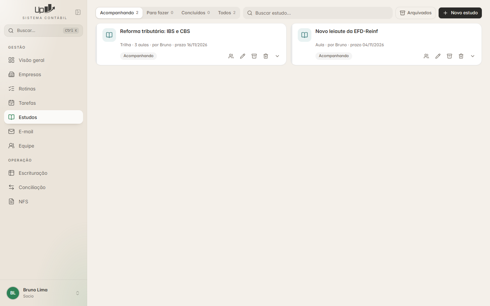
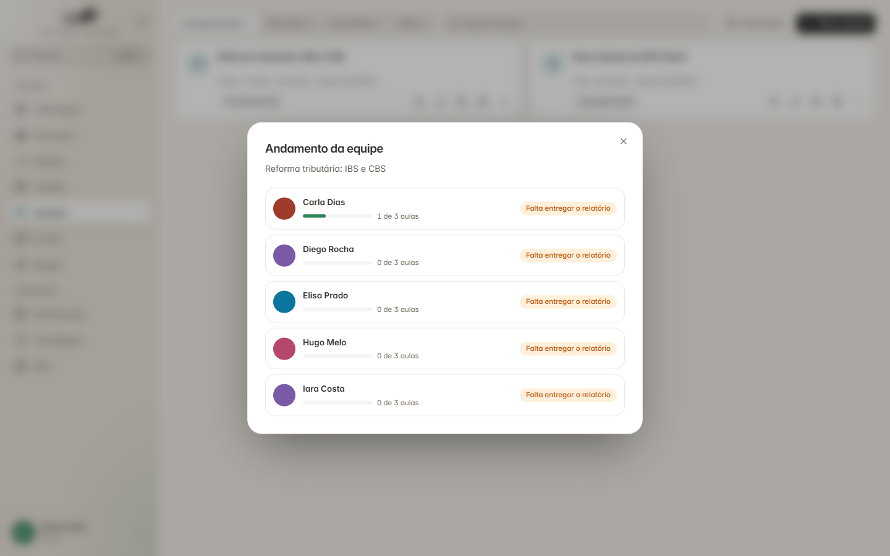
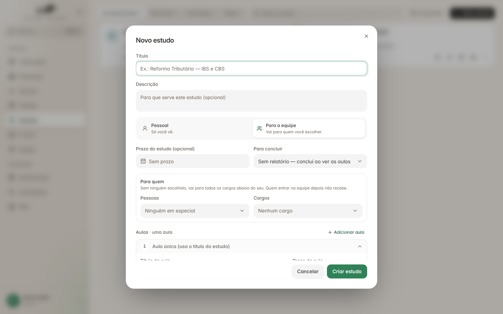

# Estudos

← [Tarefas — lista de conferência](../02-tarefas/conferencia.md) · [Índice do guia](../README.md) · [Estudos — modelo de dados](dados.md) →

---

**Nesta pasta:**

- [Estudos — modelo de dados](dados.md)
- [Estudos — regras de negócio](regras.md)
- [Estudos — API](api.md)
- [Estudos — lista de conferência](conferencia.md)

## O que é

Treinamento interno. Um estudo é uma **trilha** (várias aulas) ou uma **aula solta**.

- **Pessoal:** qualquer um cria; só quem criou vê.
- **Para a equipe:** criado por admin, sócio ou líder; vai para a equipe ou só para pessoas/cargos
  escolhidos.

A aula é a mesma para todos; **o andamento é de cada um.**

## Telas

| | |
|---|---|
|  |  |
| **Para fazer** — visão de quem estuda | **Aulas abertas**: aula vista riscada, checklist, link, prazo da aula, aviso do relatório |
|  |  |
| **Acompanhando** — visão de quem criou | **Andamento da equipe**: aulas de cada pessoa e o estado do relatório |



**Formulário:** título, descrição, Pessoal × Para a equipe, prazo, regra para concluir, para quem
(pessoas e cargos; "Sem ninguém escolhido, vai para todos os cargos abaixo do seu. Quem entrar na
equipe depois não recebe."), aulas em sanfona (título, prazo, links, resumo, anexos, checklist).

O que a tela tem (`frontend/src/rotas/estudos/TelaEstudos.tsx`, `FormEstudo.tsx`, `Janelas.tsx`):

- Abas com contagem: pessoa comum → **Para fazer** (padrão), Concluídos, Acompanhando, Todos; quem
  compartilha → **Acompanhando** primeiro. Busca, botão **Arquivados**, **Novo estudo**.
- Cartão: ícone, título, "Trilha · 3 aulas · por Fulano · prazo dd/mm/aaaa", porcentagem e "1 de 3
  aulas", selo do estado, selo do relatório ("Falta entregar o relatório"), barra de progresso no
  rodapé, ações (equipe, editar, arquivar, apagar, ver aulas).
- Cores do estado (📄 `TelaEstudos.tsx`, encurtado):

  ```ts
  const ESTADO = {
    comecar:      { nome: "A começar",    barra: "#E08A2E" },
    andamento:    { nome: "Em andamento", barra: "#5B7BC0" },
    atrasado:     { nome: "Atrasado",     barra: "#D14B3D" },
    concluido:    { nome: "Concluído",    barra: "#3E9A6B" },
    acompanhando: { nome: "Acompanhando", barra: "var(--borda)" },
    arquivado:    { nome: "Arquivado",    barra: "var(--borda)" },
  };
  ```

---

← [Tarefas — lista de conferência](../02-tarefas/conferencia.md) · [Índice do guia](../README.md) · [Estudos — modelo de dados](dados.md) →
