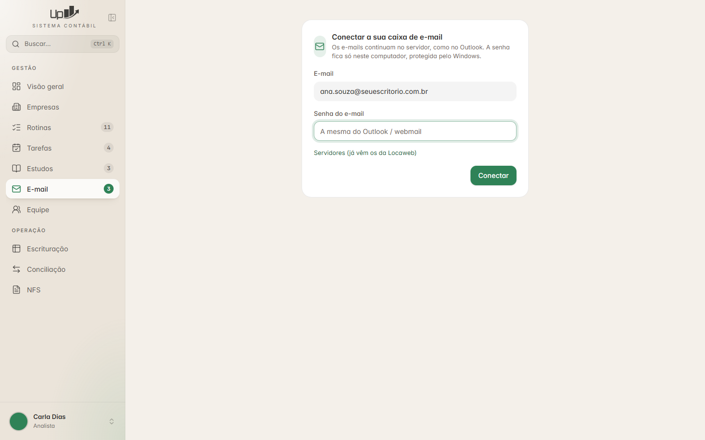
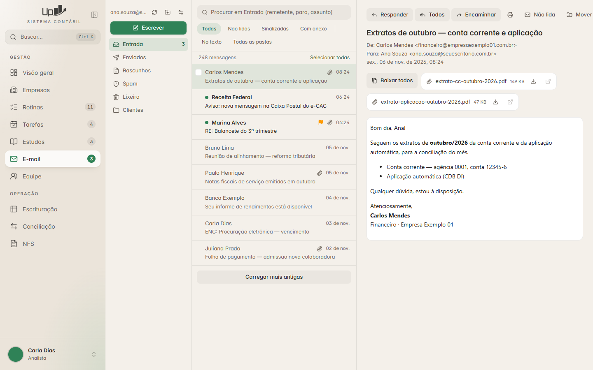
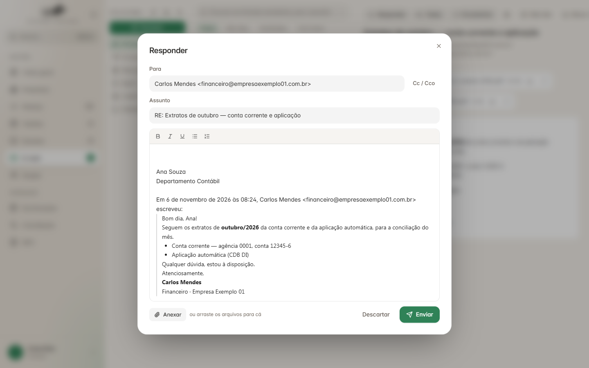

# E-mail (caixa dentro do sistema)

← [Estudos — lista de conferência](../03-estudos/conferencia.md) · [Índice do guia](../README.md) · [E-mail — conta, senha e conexões](conta-e-conexoes.md) →

---

**Nesta pasta:**

- [E-mail — conta, senha e conexões](conta-e-conexoes.md)
- [E-mail — pastas, lista e leitura](pastas-e-leitura.md)
- [E-mail — segurança](seguranca.md)
- [E-mail — escrever e enviar](escrever-e-enviar.md)
- [E-mail — avisos de e-mail novo e API](avisos-e-api.md)
- [E-mail — lista de conferência](conferencia.md)

## O que é

Substitui o Outlook: ler, baixar anexos, escrever, responder, encaminhar, rascunhos, pastas, busca.

**Arquitetura:** o computador conversa direto com o provedor por **IMAP** (ler) e **SMTP**
(enviar), com `imaplib` e `smtplib` da biblioteca padrão. **Sem servidor intermediário e sem copiar
mensagens para a base** — como o Outlook em IMAP. Sistema, Outlook e webmail enxergam as mesmas
mensagens e convivem durante a troca.

Provedor de referência: Locaweb — IMAP `email-ssl.com.br:993` (SSL) e SMTP `email-ssl.com.br:465`
(SSL). A tela deixa trocar servidor e porta. **Gmail e Microsoft 365 exigem OAuth** (outro fluxo de
login); este guia cobre e-mail + senha.

Referência: `backend/servicos/email_caixa.py` (≈1.250 linhas), `frontend/src/rotas/email/`,
plano em `docs/PLANO-EMAIL.md`.

## Telas

| | |
|---|---|
|  |  |
| **Conectar** — cada pessoa liga a sua caixa uma vez | **Caixa** — pastas, lista e leitura |

**Escrever/Responder** — Para, Cc/Cco, assunto, editor simples, assinatura e texto citado, anexar
(botão ou arrastar), Descartar e Enviar.

O que a tela tem (`frontend/src/rotas/email/TelaEmail.tsx`, `Escrever.tsx`):

- **Coluna de pastas:** endereço da conta, atualizar, nova pasta, ajustes (nome, assinatura),
  botão **Escrever**, pastas com ícone e número de não lidas; soltar e-mails arrastados numa pasta
  move.
- **Lista:** busca, filtros (Todas, Não lidas, Sinalizadas, Com anexo, No texto, Todas as pastas),
  total, "Selecionar todas", remetente, assunto, hora ou data, clipe de anexo, bandeira, bolinha +
  negrito se não lida, seleção múltipla, menu do botão direito, "Carregar mais antigas".
- **Leitura:** Responder, Todos, Encaminhar, Imprimir, Não lida, Mover, Excluir; assunto, de, para,
  data; anexos com Baixar/Abrir e "Baixar todos"; corpo na moldura segura; conversa.
- Tema escuro: o e-mail é invertido com CSS; botão "Ver com as cores originais".

---

← [Estudos — lista de conferência](../03-estudos/conferencia.md) · [Índice do guia](../README.md) · [E-mail — conta, senha e conexões](conta-e-conexoes.md) →
