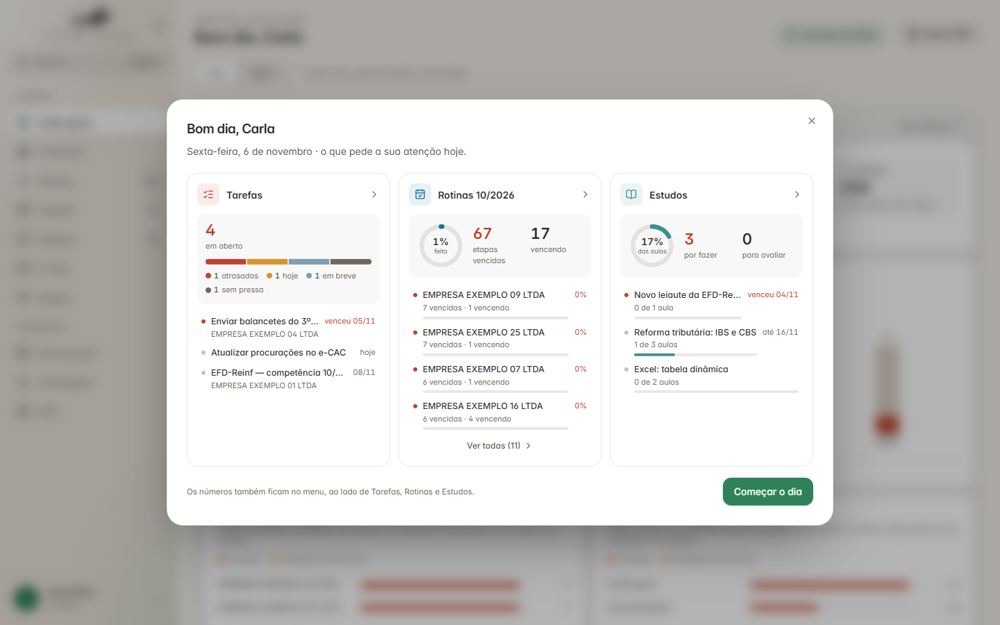
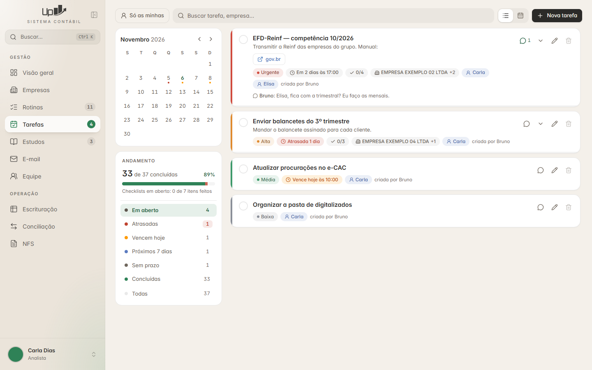
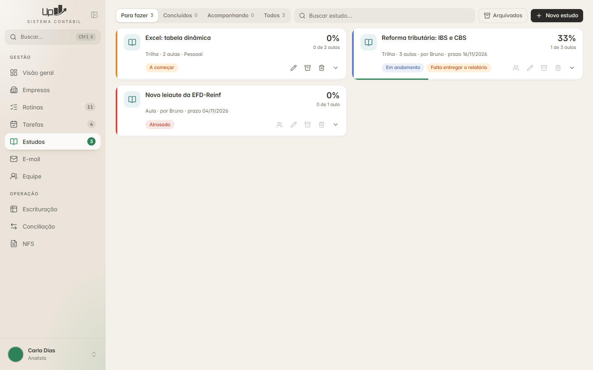
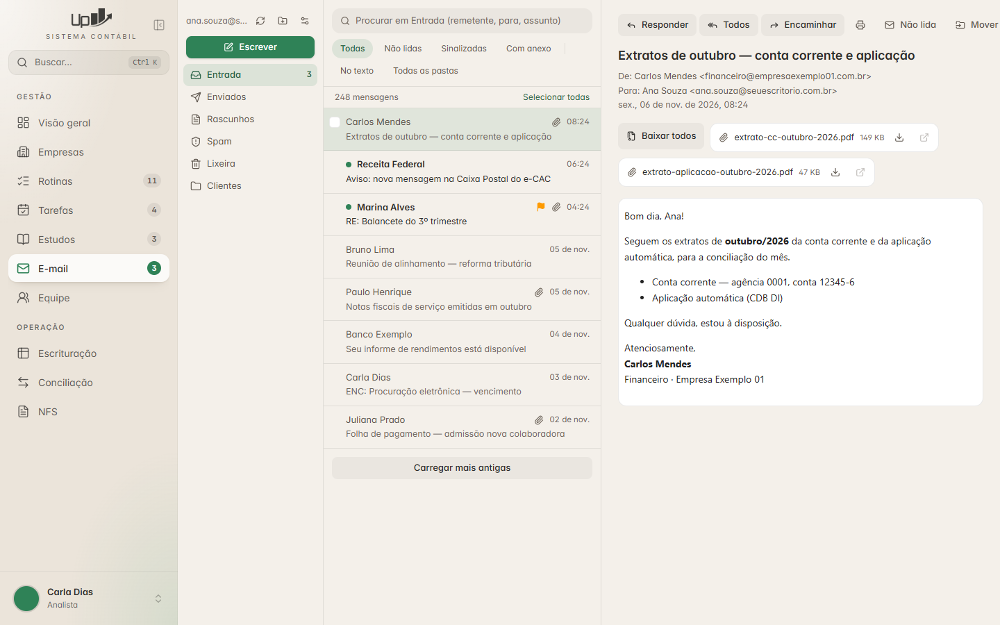

# Guia — Tarefas, Estudos e E-mail

> **Para quem é:** uma IA (ou pessoa) que vai construir estas três funções em **outro projeto**.
>
> **O que é:** o retrato fiel de como elas funcionam no *Sistema Contábil Plus* (UP Contábil):
> telas, regras de negócio, modelo de dados, API, trechos de código reais, bibliotecas e os erros
> que já custaram caro. Não precisa copiar igual: use como ponto de partida e adapte à sua stack
> e ao seu cliente.
>
> **Fotos:** tiradas na base de teste, com nomes de pessoas e empresas trocados por nomes
> fictícios. A caixa de e-mail aparece com mensagens inventadas.
>
> **Código:** os trechos marcados com 📄 são cópias do projeto de referência (às vezes encurtadas);
> os marcados com ✂️ são versões simplificadas, escritas para este guia.

---

## Como usar

Cole isto para a IA do outro projeto, ajustando o que estiver entre `< >`:

```text
Leia a pasta guia-tarefas-estudos-email do repositório recursosupcontabil antes de começar,
começando pelo README.md dela.
Quero construir <Tarefas | Estudos | E-mail> neste projeto.
- Use o guia como referência de regras, telas e armadilhas; adapte à stack deste projeto: <stack>.
- Siga 06-construcao/ordem-e-conferencia.md e a lista de conferência da pasta do módulo.
- Confira as permissões no servidor (01-base/permissoes.md), nunca só na tela.
- Antes de codar, me diga o que vai ficar diferente do guia e por quê.
```

**Leitura mínima por módulo:**

| Vai construir | Leia |
|---|---|
| Tarefas | a pasta `01-base` + a pasta `02-tarefas` + o aviso de tarefa nova em `05-lembretes` + `06-construcao` |
| Estudos | a pasta `01-base` + a pasta `03-estudos` + `06-construcao` |
| E-mail | a pasta `01-base` + a pasta `04-email` + `06-construcao` |

---

## Mapa das pastas

| Pasta | Arquivos |
|---|---|
| **[01-base](01-base/)** — vale para as três | [stack](01-base/stack.md) · [arquitetura](01-base/arquitetura.md) · [padrões de código](01-base/padroes-de-codigo.md) · [permissões](01-base/permissoes.md) · [visual](01-base/visual.md) |
| **[02-tarefas](02-tarefas/)** | [o que é e telas](02-tarefas/README.md) · [modelo de dados](02-tarefas/dados.md) · [regras](02-tarefas/regras.md) · [API](02-tarefas/api.md) · [conferência](02-tarefas/conferencia.md) |
| **[03-estudos](03-estudos/)** | [o que é e telas](03-estudos/README.md) · [modelo de dados](03-estudos/dados.md) · [regras](03-estudos/regras.md) · [API](03-estudos/api.md) · [conferência](03-estudos/conferencia.md) |
| **[04-email](04-email/)** | [o que é e telas](04-email/README.md) · [conta e conexões](04-email/conta-e-conexoes.md) · [pastas e leitura](04-email/pastas-e-leitura.md) · [segurança](04-email/seguranca.md) · [escrever e enviar](04-email/escrever-e-enviar.md) · [avisos e API](04-email/avisos-e-api.md) · [conferência](04-email/conferencia.md) |
| **[05-lembretes](05-lembretes/)** | [e-mails automáticos](05-lembretes/README.md) |
| **[06-construcao](06-construcao/)** | [testes](06-construcao/testes.md) · [ordem e conferência final](06-construcao/ordem-e-conferencia.md) · [armadilhas](06-construcao/armadilhas.md) |
| **[imagens](imagens/)** | as fotos das telas |

Cada arquivo tem, no topo e no fim, links para o anterior, o índice e o próximo — dá para ler tudo
em sequência.

---

## Visão geral em fotos

**"Seu dia"** — ao entrar, um resumo do que pede atenção (tarefas, rotinas e estudos). Os mesmos
números ficam no menu lateral, ao lado de cada item.



**[Tarefas](02-tarefas/README.md)** — painel de andamento à esquerda (cada linha é um filtro),
cartões à direita.



**[Estudos](03-estudos/README.md)** — cartões com a cor do estado, porcentagem e selo do relatório.



**[E-mail](04-email/README.md)** — pastas, lista e leitura em três colunas.



---

[Começar: Stack, bibliotecas e frameworks →](01-base/stack.md)
